# Anoxia Simulator

**Évaluation du risque d'appauvrissement en oxygène et d'accumulation de CO₂ dans les locaux où l'on stocke ou utilise des gaz inertes.**
Application de bureau (Windows, hors ligne) pour les préventeurs, responsables de sécurité de laboratoire et concepteurs de ventilation.


*[English version](README.md)*

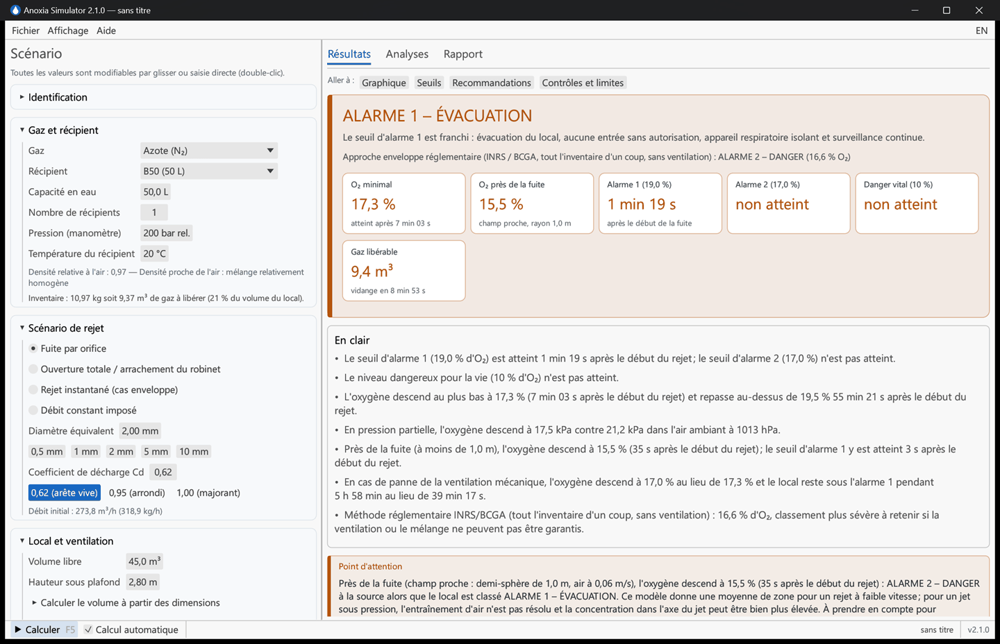

Outil d'aide à l'évaluation du **risque d'anoxie** dans un local ou un espace confiné à la suite d'un rejet de gaz inerte (azote, argon, CO₂, hélium, néon).

Il calcule l'évolution de la concentration en oxygène (et en CO₂, gaz toxique), les délais d'atteinte des seuils d'alarme, classe le risque, propose des mesures de prévention et dimensionne la ventilation nécessaire. Les résultats s'exportent dans un rapport HTML autonome.

Le moteur est accompagné d'un **dossier de validation intégré**. Les 55 cas contrôlés sont conformes : données NIST et Linde, méthodes INRS, BCGA, Fermilab, TNO et ODHMOD (AIHA), essais publiés. Voir [VALIDATION.md](VALIDATION.md).

> **Avertissement** — Modèle simplifié. Les résultats ne doivent jamais servir à déclarer une atmosphère sûre ; ils doivent être interprétés par une personne compétente en prévention des risques. Seule la mesure par un détecteur étalonné fait foi.

## Captures d'écran

| Tutoriel interactif | Scénario CO₂ (toxicité et oxygène) |
|---|---|
| 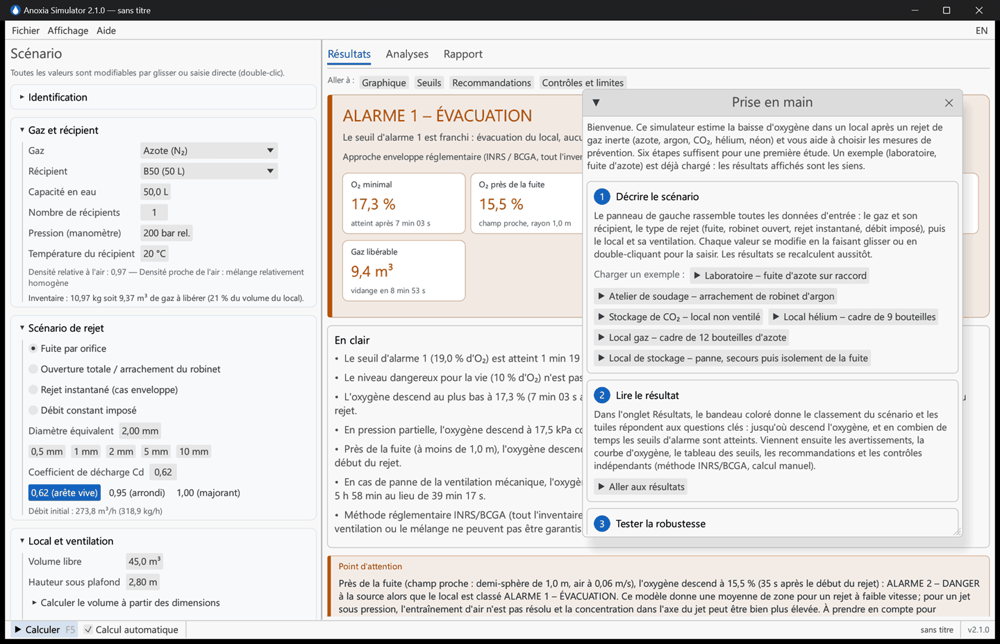 | 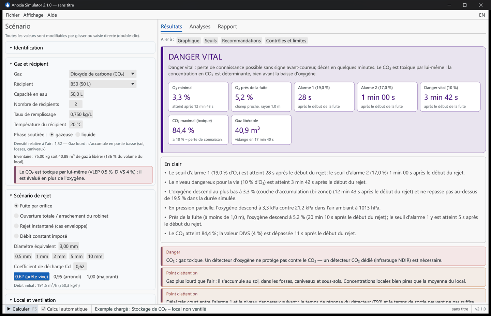 |

| Panne de ventilation | Avant / après modification de l'installation |
|---|---|
| 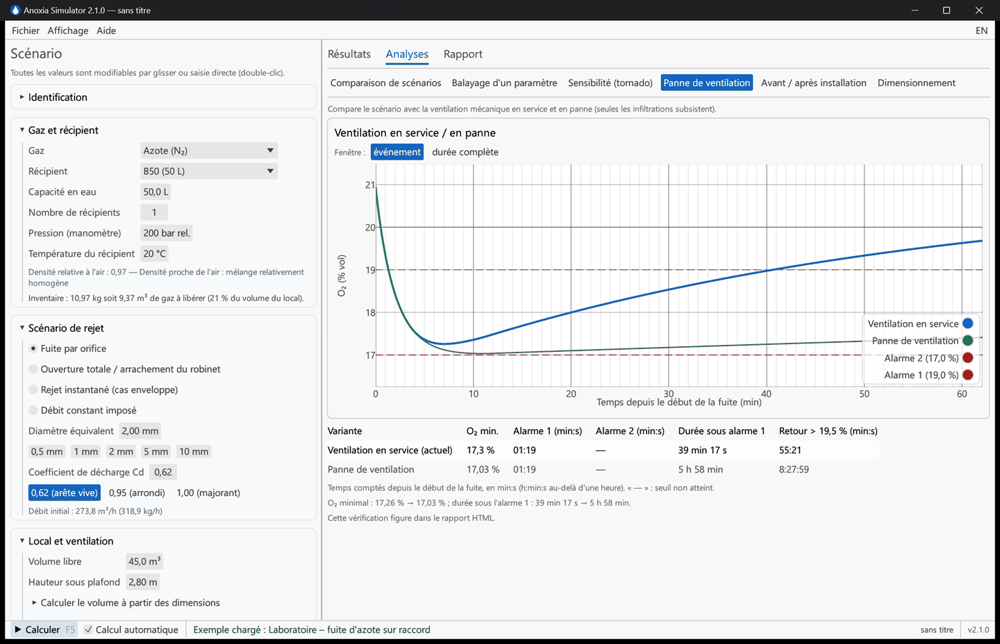 | 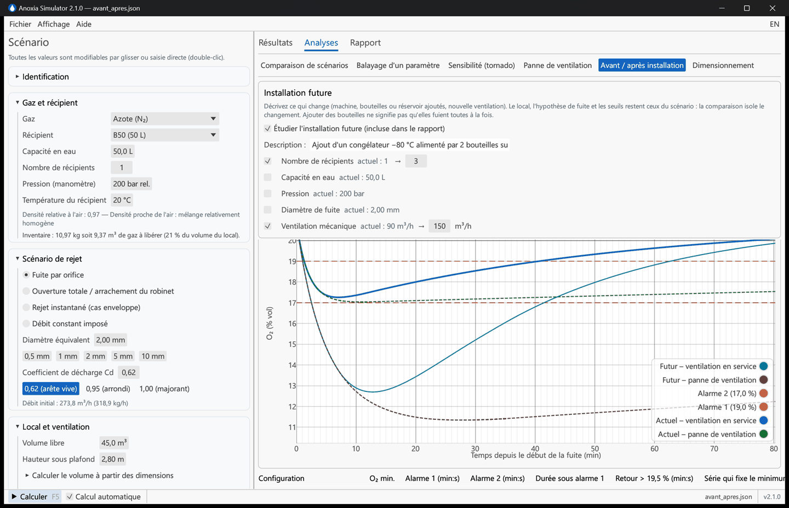 |

| Sensibilité (tornado) | Dimensionnement de la ventilation et d'un limiteur de débit |
|---|---|
| 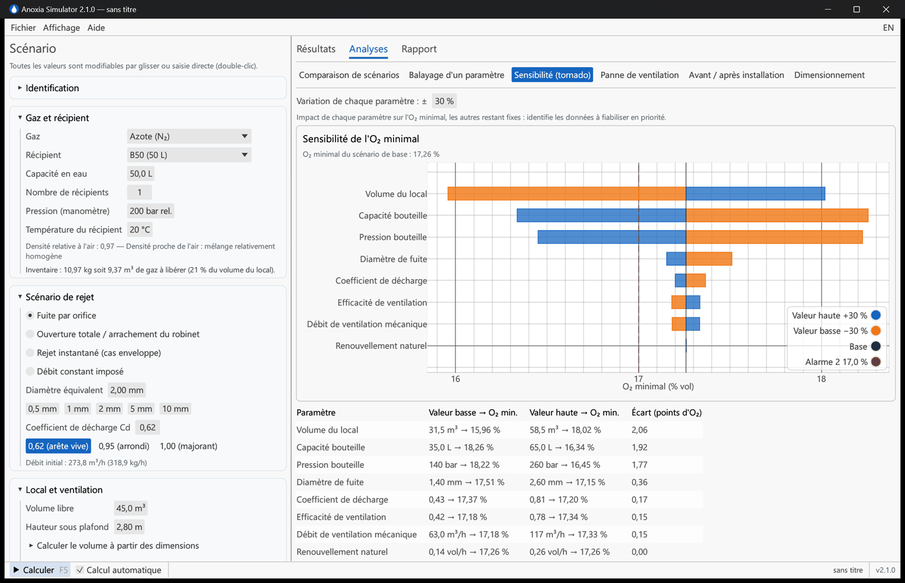 | 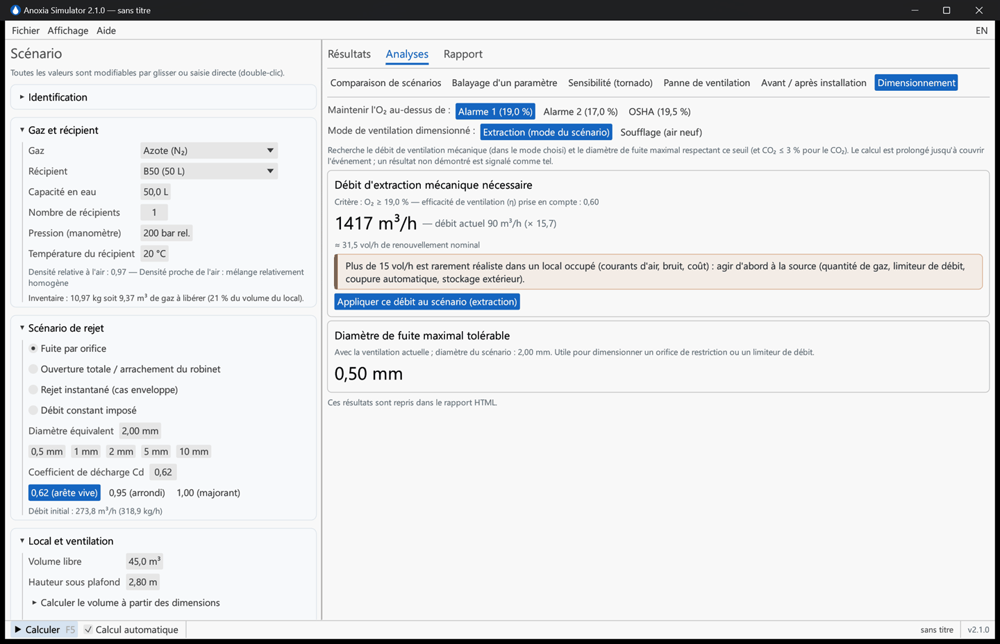 |

| Onglet Rapport, recommandations validées par le rédacteur | Dossier de validation intégré |
|---|---|
| 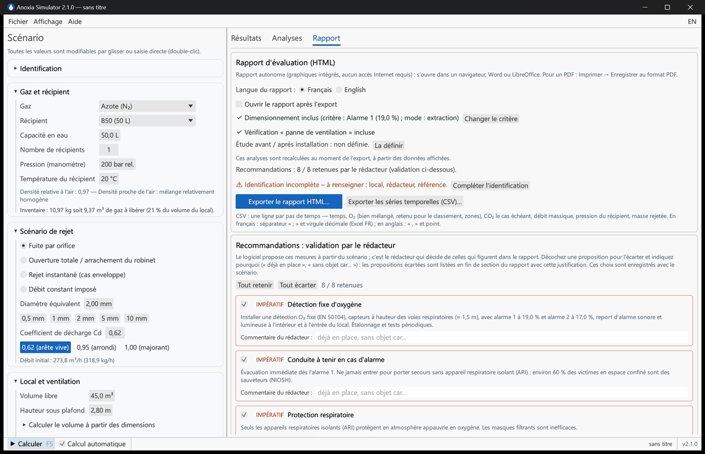 | 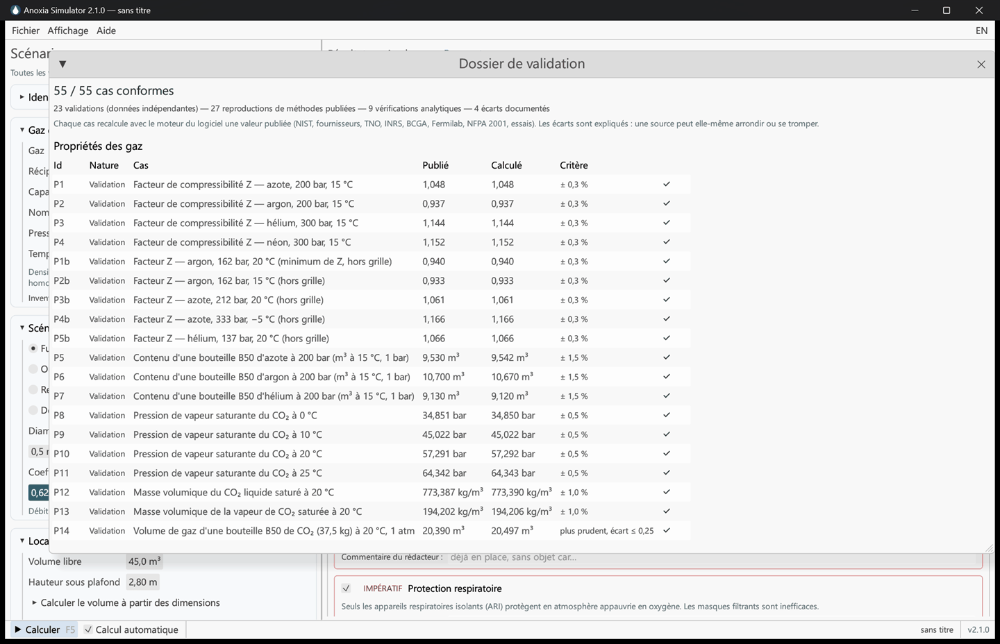 |

| Chronologie d'événements (panne, secours, isolement) | Comparaison de scénarios |
|---|---|
| 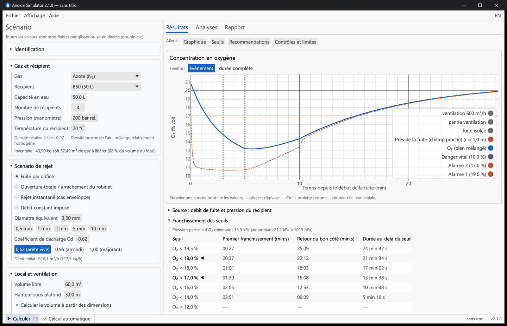 | 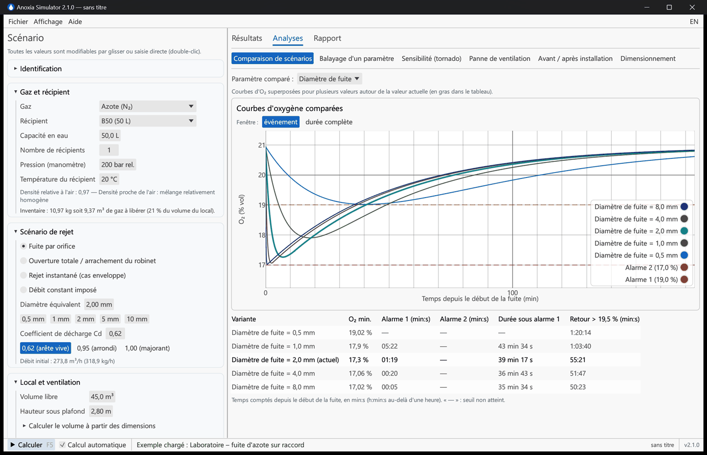 |

## Fonctionnalités

**Source et rejet**
- 5 gaz ; bouteilles B2 à B50, réservoirs, cadres de bouteilles (jusqu'à 100 récipients).
- Pression saisie telle que lue au manomètre (relative), gaz réel (table NIST REFPROP de −40 à +70 °C, jusqu'à 750 bar).
- CO₂ liquéfié : inventaire par taux de remplissage (B50 = 37,5 kg), pression de vapeur saturante, soutirage gazeux ou liquide.
- Quatre scénarios :
  - fuite par orifice ;
  - ouverture totale ou arrachement du robinet ;
  - rejet instantané (cas enveloppe, méthode INRS/BCGA) ;
  - **débit constant imposé** (procédés, gaz de protection, évaporation de liquides cryogéniques, avec une aide de conversion).
- Vidange réelle du récipient, isotherme (prudente) ou adiabatique (indicative) : la pression et le débit décroissent (régime sonique puis subsonique).
- CO₂ en bouteille pleine de liquide (au-delà de ≈ 22 °C) : rejet liquide pris en compte.

**Local et ventilation**
- Ventilation mécanique en **extraction** (air neuf = débit extrait − fuite, méthode Fermilab) ou en **soufflage**, activable pour simuler une panne.
- Renouvellement naturel toujours actif.
- Efficacité de ventilation appliquée au flux sortant total.
- Modèle bien mélangé et modèle **bi-zone** indicatif pour les gaz lourds (couche au sol) et légers (sous plafond), avec position de l'extraction.
- **Champ proche** : oxygène près du point de fuite (demi-sphère de rayon réglable, échange ½·surface·vitesse d'air, modèle Nicas / AIHA IH Mod / ODHMOD), affiché à part et signalé s'il est plus sévère que le local ; retenu pour le classement sur option.
- Calcul du volume à partir des dimensions, température et pression atmosphérique.

**Résultats**
- Classement : aucun seuil franchi, appauvrissement, alarme 1, alarme 2, danger vital (O₂ et CO₂ combinés).
- Profils de seuils France / INRS (19 % / 17 %), OSHA (19,5 % / 16 %) ou personnalisés.
- Délais d'atteinte, de retour et durée sous chaque seuil (19,5 → 6 %), pic de CO₂ et dépassement de la VLEP, de la VLCT et de la DIVS.
- Pression partielle d'oxygène (minimale et ambiante à la pression du local), avec une alerte en altitude où un même pourcentage est plus hypoxiant.
- Recommandations hiérarchisées (détection, conduite à tenir, ARI, coupure automatique, points bas...).
- Calcul en temps réel à chaque modification, avec un recalcul différé automatique pour les scénarios lents.
- Contrôles indépendants affichés à côté de chaque résultat : méthode INRS/BCGA par déplacement, efflux libre NFPA 2001, calcul manuel simplifié.
- Messages clés « en clair » (quand les seuils sont atteints, jusqu'où descend l'oxygène, ce qui change en cas de panne de ventilation), identiques à l'écran et dans le rapport.
- Recommandations proposées par le logiciel et validées par le rédacteur (cases à cocher, commentaires, mesures complémentaires), avec traçabilité des propositions écartées dans le rapport.

**Analyses**
- Comparaison de scénarios (courbes superposées), balayage d'un paramètre, sensibilité (tornado).
- Panne de ventilation : comparaison avec et sans ventilation mécanique.
- **Chronologie d'événements** : arrêt ou démarrage d'une ventilation mécanique à un débit donné, isolement de la fuite, à tout instant après le début du rejet ; le calcul s'arrête exactement sur chaque événement et l'état reste continu.
- **Avant / après installation** : l'installation actuelle et l'installation prévue (machine, bouteilles ou réservoir ajoutés, nouvelle ventilation), chacune en fonctionnement normal et en panne de ventilation, avec la série qui fixe le minimum et les durées censurées signalées.
- **Dimensionnement** : débit d'extraction nécessaire et diamètre de fuite maximal tolérable (dimensionnement d'un limiteur de débit).

**Rapports et fichiers**
- Rapport HTML autonome (graphiques SVG intégrés, fonctionne hors ligne, imprimable en PDF), en français ou en anglais.
- Export CSV des séries temporelles ; scénarios enregistrés en JSON versionné (les fichiers de la v1 sont convertis automatiquement).
- 6 scénarios d'exemple ; interface bilingue FR/EN ; thème clair ou sombre ; préférences mémorisées.
- Tutoriel interactif de prise en main et guide utilisateur illustré ([docs/GUIDE_UTILISATEUR.md](docs/GUIDE_UTILISATEUR.md)).
- Dossier de validation consultable dans l'application (*Aide → Dossier de validation*).

## Installation

Télécharger l'archive Windows depuis les *Releases* GitHub, la décompresser et lancer `Anoxia-Simulator.exe`.

Compilation depuis les sources (Rust ≥ 1.85) :

```bash
git clone https://github.com/Misterbra/anoxia-simulator.git
cd anoxia-simulator
cargo run --release --bin anoxia-gui
```

Paquet Windows distribuable : `.\build-release.ps1` (tests, clippy, build, ZIP et somme SHA-256 dans `dist/`).

L'intégration continue compile avec la version de Rust épinglée dans `.github/workflows/ci.yml` (`RUST_TOOLCHAIN`, actuellement 1.99.1) et vérifie en plus la version minimale 1.85. Avant de pousser : `rustup update`, puis `cargo fmt --all --check`, `cargo clippy --workspace --all-targets --locked -- -D warnings` et `cargo test --workspace --locked` avec cette même version.

## Utilisation

Un **tutoriel de prise en main** s'ouvre au premier lancement (et reste disponible dans *Aide → Prise en main*) : six étapes dont les boutons exécutent les actions dans le logiciel. Le [guide utilisateur](docs/GUIDE_UTILISATEUR.md) ([English version](docs/USER_GUIDE.md)) détaille chaque écran avec des captures et répond aux questions fréquentes (quel coefficient de décharge, extraction ou soufflage, pourquoi deux verdicts, écart avec la méthode INRS…).


1. Panneau de gauche : gaz et récipient, scénario de rejet, local et ventilation (l'identification sert au rapport).
2. Onglet **Résultats** : classement, délais d'alarme, graphiques, seuils, recommandations.
3. Onglet **Analyses** : robustesse (panne de ventilation, sensibilité) et dimensionnement.
4. Onglet **Rapport** : export HTML / CSV.

| Raccourci | Action |
|---|---|
| F5 | Calculer |
| F1 | Guide scientifique |
| Ctrl+N / Ctrl+O | Nouveau / Ouvrir |
| Ctrl+S / Ctrl+Maj+S | Enregistrer / Enregistrer sous |
| Ctrl+E | Exporter le rapport HTML |

## Modèle

**Débit à l'orifice** (isentropique, masse volumique amont réelle ρ0, pression P0, r = Pa/P0) :

```
sonique    : ṁ = Cd·A·√(γ·ρ0·P0)·(2/(γ+1))^((γ+1)/(2(γ−1)))
subsonique : ṁ = Cd·A·√(2·ρ0·P0·γ/(γ−1)·(r^(2/γ) − r^((γ+1)/γ)))
```

Cd = 0,62 pour un orifice à arête vive, 0,95–0,99 pour un orifice arrondi, 1,0 pour une rupture franche (TNO Yellow Book). Le récipient se vide de façon isotherme par défaut (prudent pour l'oxygène).

**Bilan dans le local** (bien mélangé, pression constante) :

```
V·dx/dt = Q_gaz − x·max(Q_gaz, η·(Q_gaz + Q_air))        O₂ = 20,95 %·(1 − x)
```

Q_air est l'air neuf entrant :
- en extraction : (débit extrait − Q_gaz), combiné en quadrature avec les infiltrations ;
- en soufflage : débit soufflé + infiltrations.

η est l'efficacité de ventilation, appliquée au flux sortant total. Les équations du local sont intégrées exactement sur chaque pas (exponentielle de matrice), l'inventaire du récipient par RK4. La masse rejetée dans le local est exactement celle perdue par le récipient.

**Hypothèses et limites** : champ proche = moyenne d'une demi-sphère pour un rejet à faible vitesse (l'entraînement d'un jet sous pression n'est pas résolu, la concentration dans l'axe du jet n'est pas bornée), modèle bi-zone indicatif, liquides cryogéniques non modélisés, refroidissement du CO₂ non modélisé. Le coefficient de décharge et l'efficacité de ventilation doivent être justifiés : utiliser l'analyse de sensibilité.

### Seuils retenus

| O₂ (% vol) | Signification |
|---|---|
| 20,95 | Air ambiant |
| < 20,5 | Appauvrissement : indicateur de fuite |
| < 19,5 | Atmosphère sous-oxygénée (OSHA 1910.146) ; le second niveau OSHA à 16 % est un choix usuel, pas une exigence du texte |
| 19 / 17 | Alarmes usuelles des détecteurs en France (INRS, EN 50104) |
| < 11 | Évanouissement possible sans signe avant-coureur (EIGA Doc. 44) |
| < 10 | Danger vital |
| < 6 | Coma en ≈ 40 s, décès |

| CO₂ (% vol) | Valeur limite |
|---|---|
| 0,5 | Valeur de la VLEP 8 h (valeur limite indicative, arrêté du 30 juin 2004 modifié ; directive 2006/15/CE), comparée au pic de concentration et non à une moyenne |
| 3 | VLCT (ACGIH STEL) |
| 4 | DIVS / IDLH (NIOSH) |
| ≥ 10 | Perte de connaissance en quelques minutes |

### Références

INRS ED 967 (espaces confinés) et ED 6088 ; EIGA Doc. 44 ; OSHA 29 CFR 1910.146 ; NIOSH Pocket Guide, NIOSH 86-110 ; arrêté du 30 juin 2004 modifié (VLEP indicatives) ; EN 50104 ; TNO Yellow Book (CPR 14E) ; Span & Wagner (1996) ; Peng & Robinson (1976).

## Architecture

```
anoxia-core/        Bibliothèque de calcul (sans interface)
  gas.rs            Propriétés des gaz, équation d'état, saturation CO₂
  flow.rs           Écoulement à l'orifice, vidange du récipient
  solver.rs         Intégration du bilan (bien mélangé, bi-zone, champ proche)
  safety.rs         Classement O₂/CO₂, recommandations, limites
  analysis.rs       Comparaisons, balayages, tornado, dimensionnement
  report.rs         Rapport HTML autonome (SVG)
  config.rs         Configuration versionnée, migration v1
  validation.rs     Dossier de validation (59 cas : 55 contrôlés par les tests, 4 documentés)
  nist_data.rs      Table Z(T, P) générée depuis NIST REFPROP (tools/nist_grid.py)
  i18n.rs           Langue, formats numériques FR/EN
anoxia-gui/         Application de bureau (egui)
```

```bash
cargo test --workspace                       # tests (solutions analytiques, conservation de masse, rapports…)
cargo run -p anoxia-core --example scenarios # valeurs de référence
cargo run -p anoxia-core --example validation --release # tableau de validation
```

## Licence

Anoxia Simulator est un logiciel libre publié sous **GNU Affero General Public License, version 3 ou ultérieure** (AGPL-3.0-or-later). Vous pouvez l'utiliser, l'étudier, le modifier et le redistribuer, à condition que toute version modifiée, y compris proposée comme service en ligne, soit diffusée sous la même licence avec son code source et la mention de l'auteur d'origine. Voir [LICENSE](LICENSE).

Une licence commerciale (intégration dans un produit propriétaire, développements spécifiques, support) est disponible auprès de l'auteur sur demande.

## Citer le logiciel

Si ce logiciel contribue à une évaluation, un rapport ou une publication, merci de le citer (voir [CITATION.cff](CITATION.cff)) :

> Brag, N. (2026). *Anoxia Simulator* (version 2.1.0) [Logiciel]. https://github.com/Misterbra/anoxia-simulator

## Auteur

Nabil Brag — [LinkedIn](https://www.linkedin.com/in/nabil-brg/) · [GitHub](https://github.com/Misterbra)
