# Anoxia Simulator

**Oxygen-depletion and CO₂ risk assessment for rooms where inert gases are stored or used.**
Desktop application (Windows, offline) for HSE engineers, laboratory safety officers and ventilation designers.


[](https://github.com/Misterbra/anoxia-simulator/actions)

*[Version française](README.fr.md)*

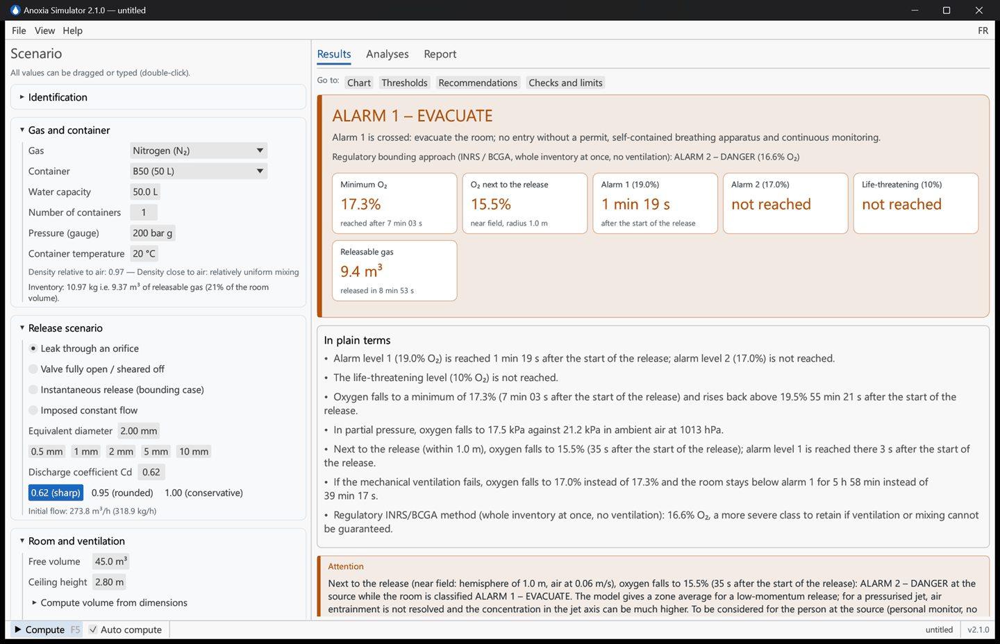

## What it does

A nitrogen, argon, CO₂, helium or neon release in a closed room pushes the oxygen down. Anoxia Simulator answers the questions an assessment has to answer:

- **How low does the oxygen go, and how fast?** Time to the alarm levels, minimum concentration, time below each level, recovery.
- **What happens if the ventilation fails?** Every scenario is also computed with the mechanical ventilation off.
- **And if it fails five minutes into the leak, or a backup fan starts, or the valve is closed?** A timeline of dated events (ventilation stops or starts, leak isolated) is computed exactly, with the markers on the curves.
- **What changes if I add a machine, cylinders or a tank?** Current and future installation, each in normal operation and in failure.
- **Which ventilation flow or flow limiter would keep the room above the alarm level?** Sizing of the extraction (or supply) flow and of the maximum tolerable leak diameter.
- **What should I write in the report?** Plain-language key messages, ranked warnings, recommendations the author validates, and a self-contained HTML report with charts.

Everything runs locally, in French or English, with an interactive tutorial at first start.

> **Disclaimer.** This is a screening model, an aid to the assessment by a competent person. Its results must never be used to declare an atmosphere safe; only a calibrated detector can do that.

## Why this tool, and how it compares

Oxygen-depletion assessments are usually done with a hand formula (whole inventory released at once, no ventilation), an institutional spreadsheet, or, at the other end, a commercial consequence-modelling package or CFD. Between the two there was no free, validated, time-dependent tool that an HSE engineer can run on a laptop and hand to an auditor with the evidence attached. Anoxia Simulator fills that gap.

| | Web calculators (Nottingham, Cryolab, supplier pages) | Institutional methods (INRS ED 155, BCGA CP 52, Fermilab FESHM 4240, JLab) | ODHMOD (AIHA, Excel) | CryoToolBox (Python) | Phast, EFFECTS | CFD (FDS, FLACS, Fluent) | **Anoxia Simulator** |
|---|---|---|---|---|---|---|---|
| Access | Free, online | Free, documents and spreadsheets | Free, published | Free, open source, no interface | Commercial licence | Commercial or free, expert work | **Free, open source (AGPL), desktop, offline** |
| Room balance over time | No (static displacement) | Analytic steady state or constant flow | Yes (Euler, imposed flow) | Yes (constant flow) | Yes | Yes, 3-D | **Yes, exact integration on each step** |
| Source: container blowdown, real gas | No | No (constant flow) | No | No | Yes | Source term supplied by the user | **Yes (isentropic orifice, NIST real-gas data, CO₂ liquid-vapour)** |
| Near field / stratification | No | No | Near field / far field | No | Partial | Full 3-D | **Near field (Nicas / ODHMOD) and indicative two-zone layer** |
| Ventilation failure, timeline of events, before / after | No | By hand | No | No | Scenario by scenario | Scenario by scenario | **Built-in studies, including dated events** |
| Sizing (required flow, flow limiter) | No | By hand | No | No | No | No | **Yes** |
| O₂ and CO₂ toxicity together | No | No | No | No | Yes | Yes | **Yes** |
| Report and recommendations | No | Templates | No | No | Yes | Expert report | **Self-contained HTML report, recommendations validated by the author** |
| Validation evidence shipped with the tool | No | Institutional | Peer-reviewed article | Tests | Vendor dossiers | Case by case | **59 reference cases recomputed live in the application** |
| Probabilistic ODH classification (fatality rate) | No | Yes (Fermilab, JLab) | No | Yes | No | No | No (deterministic by design) |

What the others do better: the Fermilab and JLab methods give a probabilistic ODH class from component failure rates, which this tool deliberately does not compute; Phast, EFFECTS and CFD resolve jets, cryogenic pools, outdoor dispersion and 3-D geometry. Anoxia Simulator is the screening step before them: it states its own limits and says when a more detailed study is needed. The comparison is detailed, with the published figures reproduced case by case, in [VALIDATION.md](VALIDATION.md).

## Screenshots

| Interactive tutorial | CO₂ scenario (toxicity and oxygen together) |
|---|---|
| 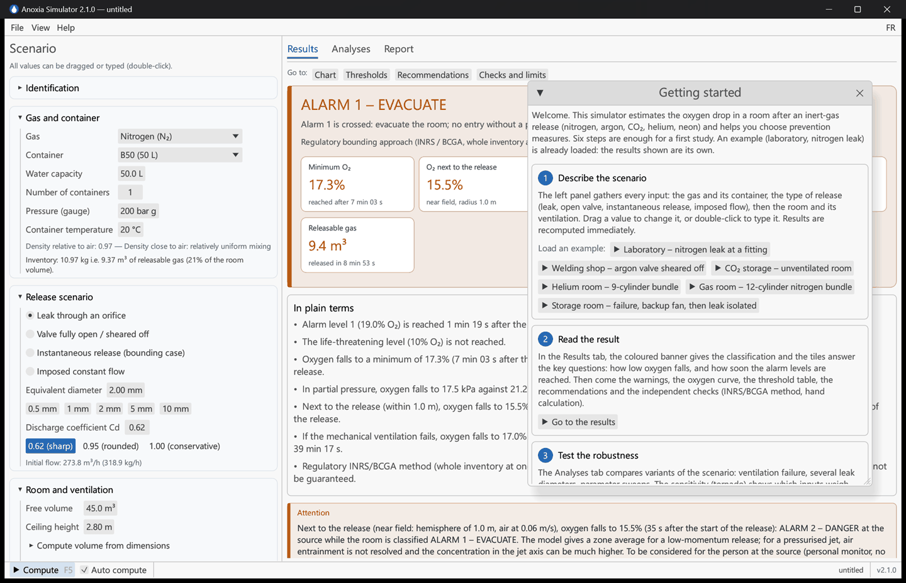 | 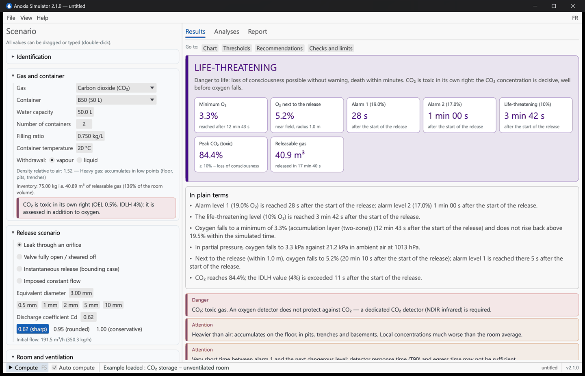 |

| Ventilation failure | Before / after an installation change |
|---|---|
| 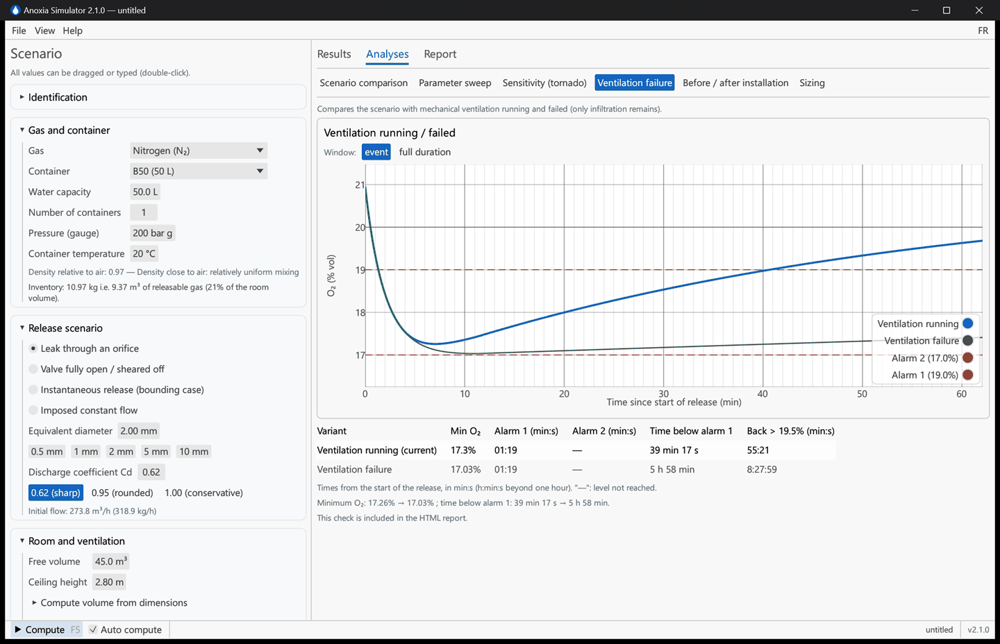 | 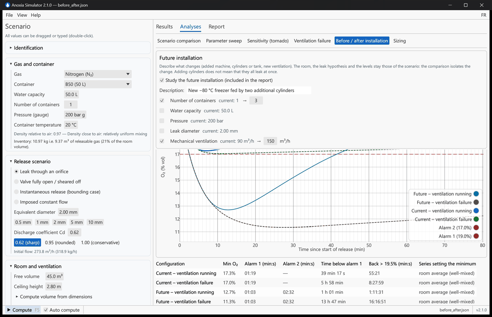 |

| Sensitivity (tornado) | Sizing of the ventilation and of a flow limiter |
|---|---|
| 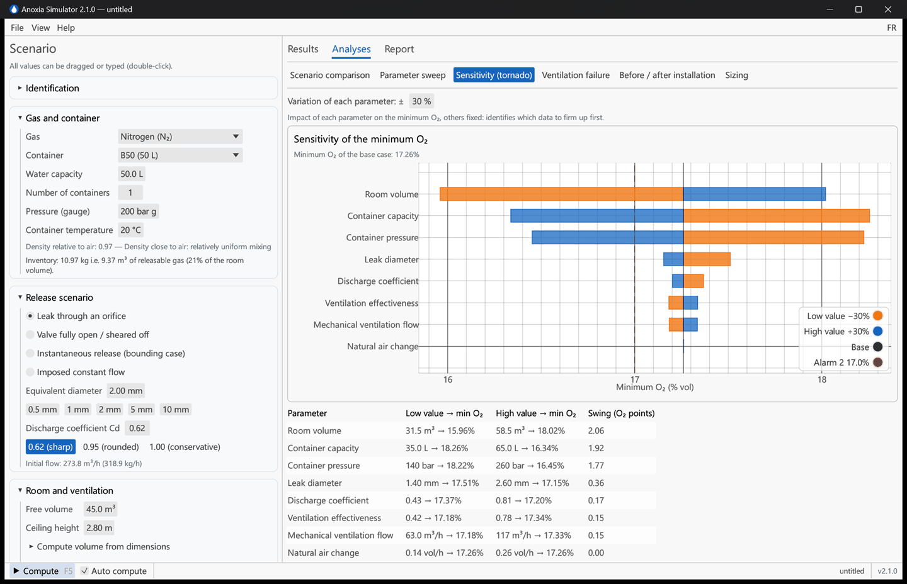 | 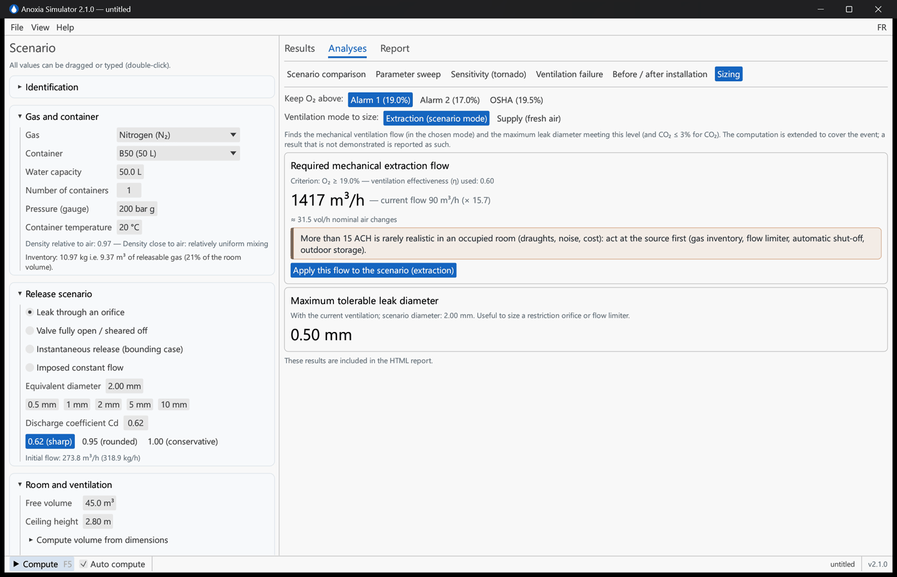 |

| Report tab, recommendations validated by the author | Built-in validation dossier |
|---|---|
| 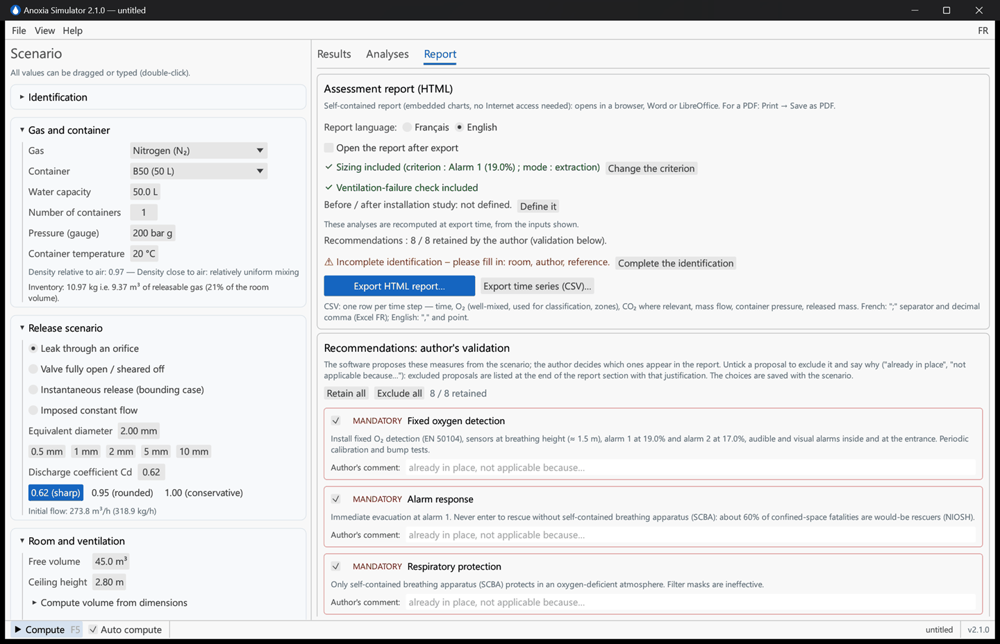 | 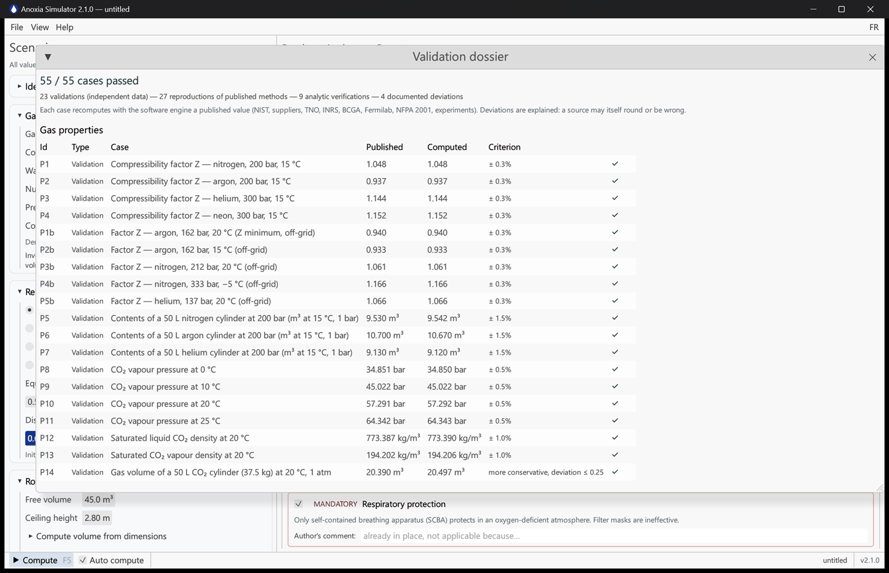 |

| Timeline of events (failure, backup fan, leak isolated) | Scenario comparison |
|---|---|
| 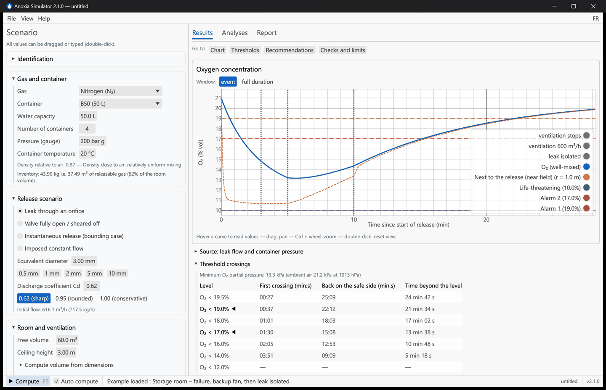 | 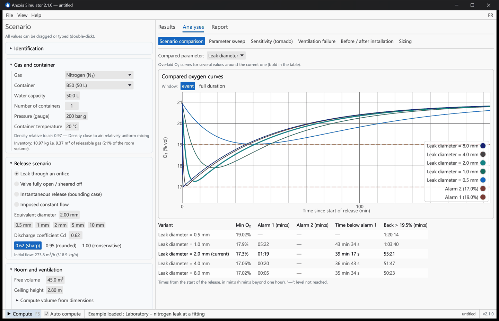 |

## Features

**Source and release**
- 5 gases; cylinders from 2 to 50 L, tanks, cylinder bundles (up to 100 containers).
- Gauge pressure as read on the regulator; real-gas behaviour from a NIST REFPROP table (−40 to +70 °C, up to 750 bar).
- Liquefied CO₂: inventory from the filling ratio, saturation pressure (Span–Wagner), gas or liquid withdrawal, liquid-full cylinders.
- Four release types: leak through an orifice, valve fully open or sheared off, instantaneous release (INRS/BCGA bounding case), imposed constant flow (processes, shielding gas, cryogenic liquid evaporation with a conversion helper).
- Real container blowdown: pressure and flow decrease over time (sonic then subsonic), isothermal by default, adiabatic as an indicative option.

**Room and ventilation**
- Mechanical ventilation in **extraction** mode (fresh air = extracted flow − gas flow) or **supply** mode, natural air change always active, ventilation effectiveness applied to the whole outgoing flow.
- Well-mixed model, indicative **two-zone model** for heavy gases (floor layer) and light gases (ceiling layer), with the location of the extraction.
- **Near field**: oxygen next to the release point (hemisphere of adjustable radius, exchange ½·surface·air speed, Nicas / AIHA IH Mod / ODHMOD model), shown separately and flagged when more severe than the room.
- Room volume from dimensions, room temperature and atmospheric pressure.

**Results**
- Classification: no level reached, depletion, alarm 1, alarm 2, life-threatening (oxygen and CO₂ combined); threshold profiles France/INRS (19 % / 17 %), OSHA (19.5 % / usual 16 %) or custom.
- Times to each level, recovery, time below each level (19.5 → 6 %), CO₂ peak against the OEL, STEL and IDLH values; times still running at the end of the computation are reported as lower bounds.
- Oxygen partial pressure (minimum and ambient at the room pressure), with a warning at altitude where the same percentage is more hypoxic.
- Key messages in plain language, ranked warnings, independent checks next to each result (INRS/BCGA displacement method, NFPA 2001 free efflux, simplified hand calculation).
- Recommendations proposed by the software and validated by the author (tick boxes, comments, additional measures), with the excluded proposals traced in the report.
- Immediate recomputation on every change.

**Analyses**
- Scenario comparison, parameter sweep, sensitivity (tornado).
- Ventilation failure, and before / after an installation change (four configurations).
- **Timeline of events**: mechanical ventilation stopping or (re)starting at a given flow, leak isolated, at any time after the start of the release; the integration lands exactly on each event and the state stays continuous.
- Sizing: ventilation flow needed (extraction or supply, stated explicitly) and maximum tolerable leak diameter; the computation is extended to cover the event and a result that is not demonstrated is reported as such.

**Reports and files**
- Self-contained HTML report (inline SVG charts, works offline, prints to PDF) in French or English.
- CSV export of the time series; scenarios saved as versioned JSON; preferences remembered.
- Six example scenarios, light or dark theme, bilingual interface, illustrated user guide ([English](docs/USER_GUIDE.md), [French](docs/GUIDE_UTILISATEUR.md)).

## Installation

Download the Windows archive from the GitHub *Releases*, unzip it and run `Anoxia-Simulator.exe`. No installation, no Internet access needed.

Build from source (Rust ≥ 1.85):

```bash
git clone https://github.com/Misterbra/anoxia-simulator.git
cd anoxia-simulator
cargo run --release --bin anoxia-gui
```

Windows package: `.\build-release.ps1` (tests, lint, build, ZIP and SHA-256 checksum in `dist/`).

## Quick start

1. **Describe the scenario** in the left panel: gas and container, release type, room and ventilation.
2. **Read the result** in the Results tab: banner, tiles, key messages, oxygen curve, thresholds, recommendations.
3. **Test the robustness** in the Analyses tab: ventilation failure, sensitivity, before / after.
4. **Size the measures**: required ventilation flow, maximum leak diameter.
5. **Document**: fill in the identification, validate the recommendations, export the HTML report.
6. **Know the limits**: scientific guide (F1) and validation dossier (Help menu).

| Shortcut | Action |
|---|---|
| F5 | Compute |
| F1 | Scientific guide |
| Ctrl+N / Ctrl+O | New / Open |
| Ctrl+S / Ctrl+Shift+S | Save / Save as |
| Ctrl+E | Export the HTML report |

## How the model works

**Orifice flow** (isentropic, real upstream density ρ₀, pressure P₀, r = Pₐ/P₀):

```
sonic     : ṁ = Cd·A·√(γ·ρ₀·P₀)·(2/(γ+1))^((γ+1)/(2(γ−1)))
subsonic  : ṁ = Cd·A·√(2·ρ₀·P₀·γ/(γ−1)·(r^(2/γ) − r^((γ+1)/γ)))
```

Cd = 0.62 for a sharp-edged orifice, 0.95–0.99 for a rounded one, 1.0 for a full-bore rupture (TNO Yellow Book). The container empties isothermally by default (conservative for oxygen).

**Room balance** (well-mixed, constant pressure):

```
V·dx/dt = Q_gas − x·max(Q_gas, η·(Q_gas + Q_air))        O₂ = 20.95 %·(1 − x)
```

Q_air is the fresh air entering the room: (extracted flow − Q_gas) combined in quadrature with infiltration in extraction mode, supplied flow + infiltration in supply mode. η is the ventilation effectiveness, applied to the whole outgoing flow. The room equations are integrated exactly on each step (matrix exponential, also for the two-zone and near-field systems), the container inventory with RK4; threshold crossing times are located on the exact solution. The mass released into the room is exactly the mass lost by the container.

**Assumptions and limits.** The near field is the average of a hemisphere for a low-momentum release: the entrainment of a pressurised jet is not resolved and the concentration in the jet axis is not bounded. The two-zone model is indicative. Cryogenic pools and the cooling of a CO₂ cylinder are not modelled; a liquid-full CO₂ cylinder is computed at saturation pressure, which underestimates the compressed liquid. The discharge coefficient and the ventilation effectiveness are inputs to be justified: use the sensitivity analysis.

### Levels used

| O₂ (% vol) | Meaning |
|---|---|
| 20.95 | Ambient air |
| < 20.5 | Depletion: leak indicator |
| < 19.5 | Oxygen-deficient atmosphere (OSHA 1910.146); the 16 % second level is a usual choice, not a requirement of the text |
| 19 / 17 | Usual detector alarms in France (INRS, EN 50104) |
| < 11 | Fainting possible without warning (EIGA Doc. 44) |
| < 10 | Life-threatening |
| < 6 | Coma in ≈ 40 s, death |

| CO₂ (% vol) | Limit value |
|---|---|
| 0.5 | 8-h OEL value (French indicative limit, arrêté du 30 juin 2004; directive 2006/15/EC), compared with the peak concentration, not with an average |
| 3 | STEL (ACGIH) |
| 4 | IDLH (NIOSH) |
| ≥ 10 | Unconsciousness within minutes |

## Validation

The engine ships with a **built-in validation dossier** of 59 cases, run by the test suite and recomputed live in the application (*Help → Validation dossier*): NIST and Linde data, INRS, BCGA, Fermilab, TNO, Crowl & Louvar, York and Nottingham methods, NFPA 2001, NRC Canada, calorimeter, MiniCLEAN and Factory Mutual experiments, and the published examples of ODHMOD (AIHA). 55 checked cases pass; 4 documented items state a methodological difference or a datum still to be confirmed. Each case is classified as a validation against independent data, a reproduction of a published method, or an analytic verification. See [VALIDATION.md](VALIDATION.md).

**References.** INRS ED 967 (confined spaces) and ED 6088; EIGA Doc. 44; OSHA 29 CFR 1910.146; NIOSH Pocket Guide, NIOSH 86-110; arrêté du 30 juin 2004 (indicative OELs); EN 50104; TNO Yellow Book (CPR 14E); Span & Wagner (1996); Peng & Robinson (1976); Nicas (1996); Stefana et al. (2021), ODHMOD.

## Architecture

```
anoxia-core/        Calculation library (no interface)
  gas.rs            Gas properties, equation of state, CO₂ saturation
  flow.rs           Orifice flow, container blowdown
  solver.rs         Room balance (well-mixed, two-zone, near field)
  safety.rs         O₂/CO₂ classification, recommendations, limits
  analysis.rs       Comparisons, sweeps, tornado, before/after, sizing
  report.rs         Self-contained HTML report (SVG), CSV
  config.rs         Versioned configuration, legacy migration
  validation.rs     Validation dossier (59 cases, run by the tests)
  nist_data.rs      Z(T, P) table generated from NIST REFPROP (tools/nist_grid.py)
  i18n.rs           Language, FR/EN number formats
anoxia-gui/         Desktop application (egui)
```

```bash
cargo test --workspace                                   # analytic solutions, mass conservation, reports…
cargo run -p anoxia-core --example validation --release  # validation table
```

Continuous integration builds with the Rust version pinned in `.github/workflows/ci.yml` and checks the minimum supported version (1.85). Before pushing: `cargo fmt --all --check`, `cargo clippy --workspace --all-targets --locked -- -D warnings`, `cargo test --workspace --locked`.

## Documentation

- [User guide (English)](docs/USER_GUIDE.md) · [Guide utilisateur (français)](docs/GUIDE_UTILISATEUR.md)
- [Validation dossier](VALIDATION.md) · [Changelog](CHANGELOG.md)
- In the application: interactive tutorial, scientific guide (F1), validation dossier.

## Licence

Anoxia Simulator is free software released under the **GNU Affero General Public License, version 3 or later** (AGPL-3.0-or-later). You may use it, study it, modify it and redistribute it, provided that any modified version, including one offered as a network service, is distributed under the same licence with its source code and the original copyright notice. See [LICENSE](LICENSE).

A commercial licence (integration in a proprietary product, custom developments, support) is available from the author on request.

## Citing

If this software contributes to an assessment, a report or a publication, please cite it (see [CITATION.cff](CITATION.cff)):

> Brag, N. (2026). *Anoxia Simulator* (version 2.1.0) [Computer software]. https://github.com/Misterbra/anoxia-simulator

## Author

Nabil Brag — [LinkedIn](https://www.linkedin.com/in/nabil-brg/) · [GitHub](https://github.com/Misterbra)
