# Guide utilisateur — Anoxia Simulator 2.1

*English version: [USER_GUIDE.md](USER_GUIDE.md).*

Ce guide s'adresse aux préventeurs, responsables QHSE, ingénieurs sécurité et responsables de laboratoire. Il explique comment réaliser une étude de risque d'anoxie avec le logiciel, du premier lancement à l'export du rapport. Les équations et les références scientifiques sont décrites dans le guide intégré (*Aide → Guide scientifique et méthode*, touche F1) ; la comparaison aux données de référence est dans [VALIDATION.md](../VALIDATION.md).

> **Rappel important.** Le logiciel est un outil d'aide à l'évaluation. Ses résultats ne doivent jamais servir à déclarer une atmosphère sûre : seule la mesure par un détecteur étalonné fait foi, et l'étude doit être validée par une personne compétente.

## Sommaire

1. [Installation et premier lancement](#1-installation-et-premier-lancement)
2. [Décrire le scénario](#2-décrire-le-scénario)
3. [Lire les résultats](#3-lire-les-résultats)
4. [Analyser la robustesse](#4-analyser-la-robustesse)
5. [Dimensionner les mesures de prévention](#5-dimensionner-les-mesures-de-prévention)
6. [Documenter, enregistrer, exporter](#6-documenter-enregistrer-exporter)
7. [Exemples fournis](#7-exemples-fournis)
8. [Raccourcis et astuces](#8-raccourcis-et-astuces)
9. [Questions fréquentes](#9-questions-fréquentes)

---

## 1. Installation et premier lancement

**Installation.** Téléchargez l'archive `Anoxia-Simulator-vX.Y.Z-windows.zip`, décompressez-la dans un dossier de votre choix et lancez `Anoxia-Simulator.exe`. Aucune installation ni connexion Internet n'est nécessaire. Le logiciel fonctionne sous Windows 10 et 11.

**Premier lancement.** Un tutoriel de prise en main s'ouvre : six étapes, chacune avec un bouton qui exécute l'action correspondante dans le logiciel (charger un exemple, ouvrir un onglet, etc.). Vous pouvez le fermer à tout moment et le retrouver dans *Aide → Prise en main*. La case *Afficher au démarrage* permet de ne plus l'afficher.

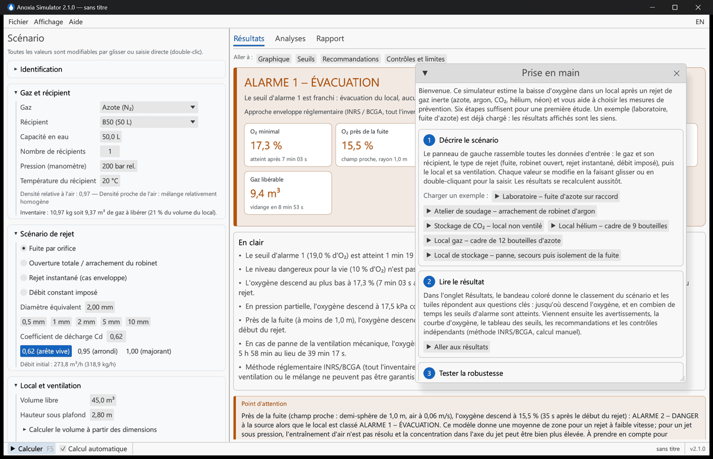

**Organisation de l'écran.**

| Zone | Rôle |
|---|---|
| Panneau de gauche « Scénario » | Toutes les données d'entrée, regroupées en sections dépliables. |
| Onglet **Résultats** | Classement du scénario, délais d'alarme, courbes, seuils, recommandations. |
| Onglet **Analyses** | Comparaisons, panne de ventilation, sensibilité, dimensionnement. |
| Onglet **Rapport** | Export du rapport HTML et des courbes (CSV). |
| Barre d'état (bas) | Bouton *Calculer* (F5), calcul automatique, messages, nom du fichier, version. |

Les préférences (langue, thème sombre, affichage du tutoriel) sont mémorisées d'une session à l'autre. Le bouton **EN / FR** en haut à droite bascule la langue de toute l'interface et des rapports.

## 2. Décrire le scénario

Toutes les valeurs numériques se modifient en les faisant glisser avec la souris, ou en double-cliquant pour les saisir au clavier. Par défaut, les résultats se recalculent à chaque modification (case *Calcul automatique*) ; une simulation prend quelques millisecondes.

### 2.1 Gaz et récipient

- **Gaz** : azote, argon, CO₂, hélium ou néon. La densité relative à l'air est rappelée ; les gaz lourds (argon, CO₂) s'accumulent en partie basse, les gaz légers (hélium, néon) en partie haute.
- **Récipient** : bouteilles B2 à B50, réservoirs, ou capacité libre. Pour un cadre ou une batterie de bouteilles raccordées sur un même collecteur, indiquez le **nombre de récipients**.
- **Pression (manomètre)** : la pression lue sur le manomètre, en bar relatifs (200 ou 300 bar pour une bouteille pleine). Le contenu réel est calculé avec les propriétés de gaz réel (tables NIST), conformes aux fiches des fournisseurs à 1 % près.
- **CO₂** : le gaz est stocké liquéfié ; on saisit le **taux de remplissage** (0,75 kg/L pour une B50 de 37,5 kg) et la **phase soutirée** (gazeuse pour une bouteille debout, liquide avec tube plongeur ou bouteille couchée, beaucoup plus rapide). Au-delà d'environ 22 °C, une bouteille remplie à 0,75 kg/L est pleine de liquide : le logiciel en tient compte et le signale.
- **Température du récipient** : influe sur le contenu et, pour le CO₂, sur la pression de saturation.

L'**inventaire** (masse et volume de gaz libérable, en % du volume du local) est affiché sous les champs : c'est un premier ordre de grandeur du risque.

### 2.2 Scénario de rejet

| Scénario | Quand l'utiliser | Paramètres |
|---|---|---|
| **Fuite par orifice** | Fuite sur un raccord, un flexible, un détendeur. | Diamètre équivalent (0,5 à 3 mm pour un raccord), coefficient de décharge Cd. |
| **Ouverture totale / arrachement du robinet** | Robinet grand ouvert (siège ≈ 4 mm) ou arraché (col de bouteille ≈ 10 à 15 mm). | Diamètre, Cd = 1 par défaut (majorant). |
| **Rejet instantané (cas enveloppe)** | Borne supérieure : tout l'inventaire libéré d'un coup, méthode de l'INRS (ED 155) et de la BCGA (CP 52). | Aucun. |
| **Débit constant imposé** | Débit connu : ligne de procédé, gaz de protection de soudage, évaporation d'azote liquide. | Débit (m³/h) et durée. Une aide convertit les L/min et les litres de liquide cryogénique (LN₂, LAr, LHe). |

**Coefficient de décharge Cd** (TNO Yellow Book) : 0,62 pour un orifice à arête vive (valeur usuelle), 0,95 pour un orifice arrondi, 1,0 en hypothèse majorante. Le **débit initial** calculé s'affiche sous les champs.

### 2.3 Local et ventilation

- **Volume libre** : volume d'air du local, déduction faite des équipements volumineux. Le lien *Calculer le volume à partir des dimensions* fait le produit L × l × H.
- **Ventilation mécanique en service** : décochez la case pour simuler une panne.
  - **Extraction (local en dépression)** : cas le plus courant pour un local à risque. L'air neuf qui entre vaut le débit extrait moins le débit de gaz rejeté (méthode Fermilab FESHM 4240) : c'est l'hypothèse prudente, retenue par défaut.
  - **Soufflage / double flux** : le débit du ventilateur est entièrement de l'air neuf.
- **Renouvellement naturel** : infiltrations, toujours présentes. Repères : 0 à 0,2 vol/h pour un local très étanche (chambre froide), 0,2 à 0,5 pour un local fermé, 0,5 à 1 pour un local technique peu étanche, plus de 1 si les portes sont souvent ouvertes.
- **Efficacité de ventilation η** : part du flux réellement utile à la dilution. 1 = mélange parfait (théorique), 0,8 bon brassage, 0,6 valeur prudente usuelle, 0,4 brassage médiocre (court-circuit entre soufflage et extraction).
- **Événements pendant le rejet** (section repliée) : une chronologie d'événements datés, comptés depuis le début du rejet. Trois types : *arrêt de la ventilation mécanique* (panne, coupure électrique), *démarrage d'une ventilation* (ventilateur de secours, extraction d'urgence asservie au détecteur, relance) à un débit donné en extraction ou en soufflage, et *isolement de la fuite* (vanne fermée, coupure automatique : plus de gaz n'entre). Le calcul s'arrête exactement sur chaque événement, les événements simultanés sont appliqués dans un ordre fixe (arrêt, démarrage, isolement) et ils apparaissent en pointillés verticaux sur les courbes et dans le rapport. Sans événement, la ventilation décrite ci-dessus fonctionne pendant toute la durée. L'étude *panne de ventilation* de l'onglet Analyses reste une panne totale dès le début, sans secours.

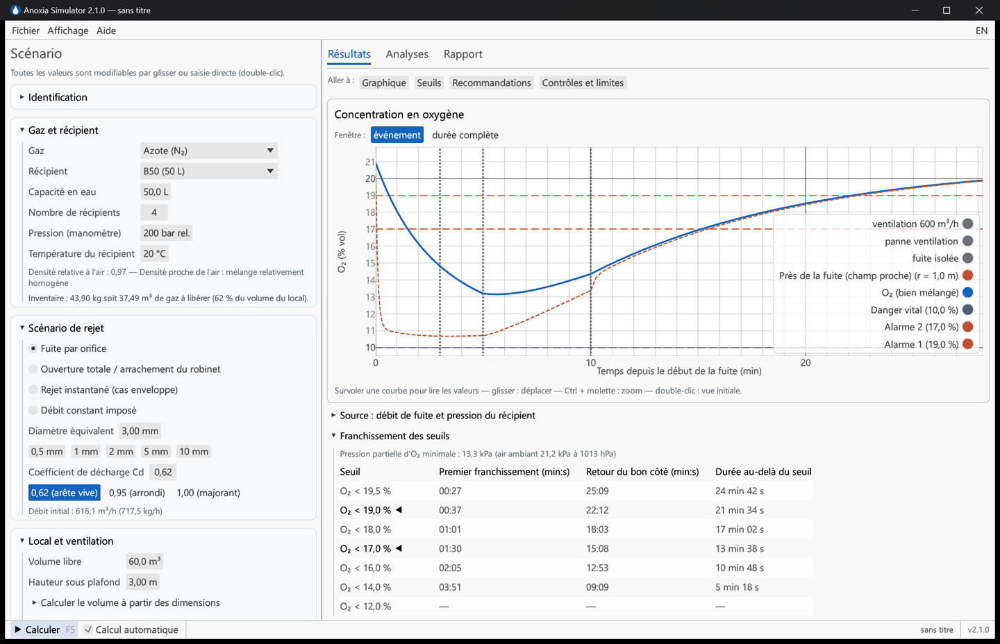

*Exemple de chronologie : l'extraction tombe en panne 3 min après le début de la fuite, une extraction d'urgence démarre à 5 min, la fuite est isolée à 10 min ; les événements sont énoncés en clair et marqués sur la courbe.*

### 2.4 Seuils d'alarme et options avancées

- **Seuils d'alarme O₂** : profil *France – INRS* (19 % et 17 %, réglages usuels des détecteurs), *OSHA* (19,5 % et 16 %) ou personnalisé.
- **Modèle bi-zone** (section *Options avancées*) : activé automatiquement pour les gaz lourds et légers ; il estime la concentration dans la couche d'accumulation (sol ou plafond). Ses paramètres (épaisseur de couche, part du rejet dans la couche, échange entre zones, position de l'extraction) sont des hypothèses : le résultat est **indicatif**, et le classement retient le plus défavorable des deux modèles.
- **Champ proche** (*Options avancées*, activé par défaut) : oxygène près du point de fuite, dans une demi-sphère de rayon réglable (1 m par défaut) qui échange avec le reste du local à ½ × surface × vitesse d'air (0,06 m/s par défaut, valeur prudente ; 0,05 à 0,3 m/s mesurés en atelier). C'est le modèle champ proche / champ lointain de l'hygiène industrielle (Nicas, AIHA IH Mod, ODHMOD). Il donne une moyenne de zone pour un rejet à faible vitesse : pour un jet sous pression, l'entraînement d'air n'est pas résolu et la concentration dans l'axe du jet peut être bien plus élevée. Par défaut il est affiché à part et signalé s'il est plus sévère ; la case *Retenir le champ proche pour le classement* l'intègre au classement.
- **Vidange du récipient** : isotherme par défaut (prudente) ; adiabatique en option (indicative, gaz parfait).
- **Durée maximale simulée**, température et pression atmosphérique du local.

## 3. Lire les résultats

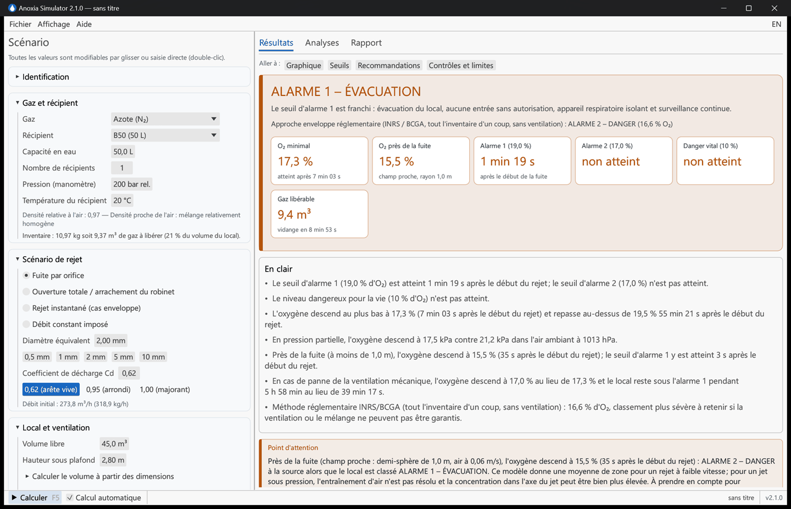

De haut en bas :

1. **Bandeau coloré** : le classement du scénario, de « aucun seuil franchi » à « danger vital », avec une phrase de conclusion. Lorsque la méthode réglementaire par déplacement (INRS/BCGA) donne un classement plus sévère que la simulation, il est indiqué sur une seconde ligne.
   - **En clair** : juste sous le bandeau, trois à cinq phrases disent l'essentiel sans jargon : quand les seuils d'alarme sont atteints (« 2 s après le début du rejet »), jusqu'où descend l'oxygène et quand il remonte, le CO₂ le cas échéant, et ce qui change si la ventilation mécanique tombe en panne. Les mêmes phrases ouvrent le rapport.
2. **Tuiles** : O₂ minimal et instant où il est atteint, O₂ près de la fuite (champ proche), délai avant l'alarme 1, l'alarme 2 et 10 % d'O₂, CO₂ maximal pour le CO₂, volume de gaz libérable et durée de vidange (ou volume réellement rejeté lorsque la fuite est isolée).
3. **Avertissements**, classés par gravité : CO₂ toxique, gaz lourd ou léger, délai d'évacuation court, modèle bi-zone indicatif, etc.
4. **Courbe d'oxygène** : par défaut, la fenêtre « événement » est centrée sur la baisse d'O₂ ; « durée complète » montre tout le retour à la normale. Survolez la courbe pour lire les valeurs ; Ctrl + molette pour zoomer, glisser pour déplacer, double-clic pour revenir à la vue initiale. Pour le CO₂, une seconde courbe montre la concentration en CO₂ face à la VLEP (0,5 %), la VLCT (3 %) et la DIVS (4 %).
5. **Source** (repliée) : débit de fuite et pression du récipient au cours de la vidange.
6. **Franchissement des seuils** : la **pression partielle d'oxygène** minimale (kPa) face à la valeur ambiante à la pression du local, puis, pour chaque niveau d'O₂ (et de CO₂), le premier franchissement, le retour du bon côté et la durée au-delà du seuil. Le délai indicatif entre l'alarme 1 et le niveau dangereux suivant est rappelé. En dessous d'environ 900 hPa (altitude), un avertissement rappelle qu'un même pourcentage est plus hypoxiant.
7. **Recommandations** hiérarchisées (impératif, fortement recommandé, bonne pratique) : détection, conduite à tenir, protection respiratoire (ARI uniquement), coupure automatique, formation, points bas, fiabilité de la ventilation. Ce sont des propositions : c'est le rédacteur qui décide, dans l'onglet *Rapport*, de celles qui figurent dans le rapport (voir § 6).
8. **Contrôles indépendants** : les trois calculs « tout l'inventaire d'un coup, sans ventilation » (méthode par déplacement INRS/BCGA, efflux libre NFPA 2001, calcul manuel simplifié que refera un auditeur), avec leur classement.
9. **Hypothèses et limites du modèle**, avertissement et date du calcul.

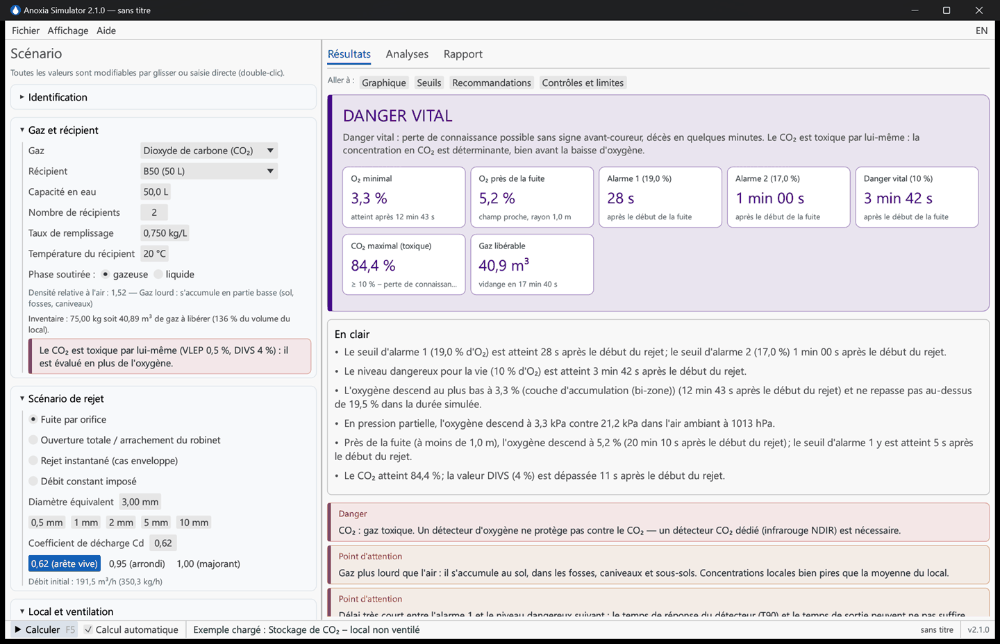

*Cas CO₂ : les libellés et les seuils propres au CO₂ s'affichent, la couche basse du modèle bi-zone est tracée.*

## 4. Analyser la robustesse

L'onglet **Analyses** relance des dizaines de simulations en arrière-plan ; les résultats sont mis en cache et se mettent à jour quand les paramètres changent.

| Étude | Ce qu'elle montre |
|---|---|
| **Comparaison de scénarios** | Courbes d'O₂ pour plusieurs valeurs d'un paramètre (diamètre de fuite, volume, débit de ventilation…) autour de la valeur actuelle, avec un tableau des délais. |
| **Balayage d'un paramètre** | O₂ minimal et délais d'alarme en fonction d'un paramètre, sur une plage réglable. |
| **Sensibilité (tornado)** | Impact de ± 30 % sur chaque paramètre : identifie les données à fiabiliser en priorité. |
| **Panne de ventilation** | Le même scénario avec et sans ventilation mécanique : O₂ minimal, durée sous l'alarme 1, retour au-dessus de 19,5 %. |
| **Avant / après installation** | L'installation actuelle et l'installation prévue (récipients ajoutés, pression, fuite, ventilation), chacune en fonctionnement normal et en panne de ventilation. Décrivez le changement, cochez les valeurs modifiées : quatre courbes, un tableau avec la série qui fixe le minimum, et des durées marquées « ≥ » quand le seuil est encore franchi à la fin du calcul. L'hypothèse de fuite reste celle du scénario : ajouter des bouteilles ne signifie pas qu'elles fuient toutes ensemble. L'étude est enregistrée avec le scénario et reprise dans le rapport. |

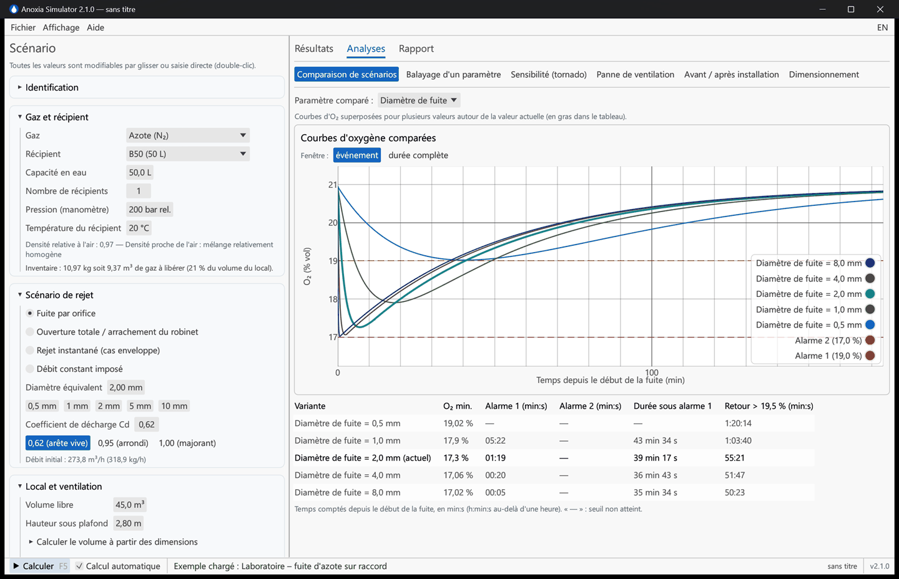

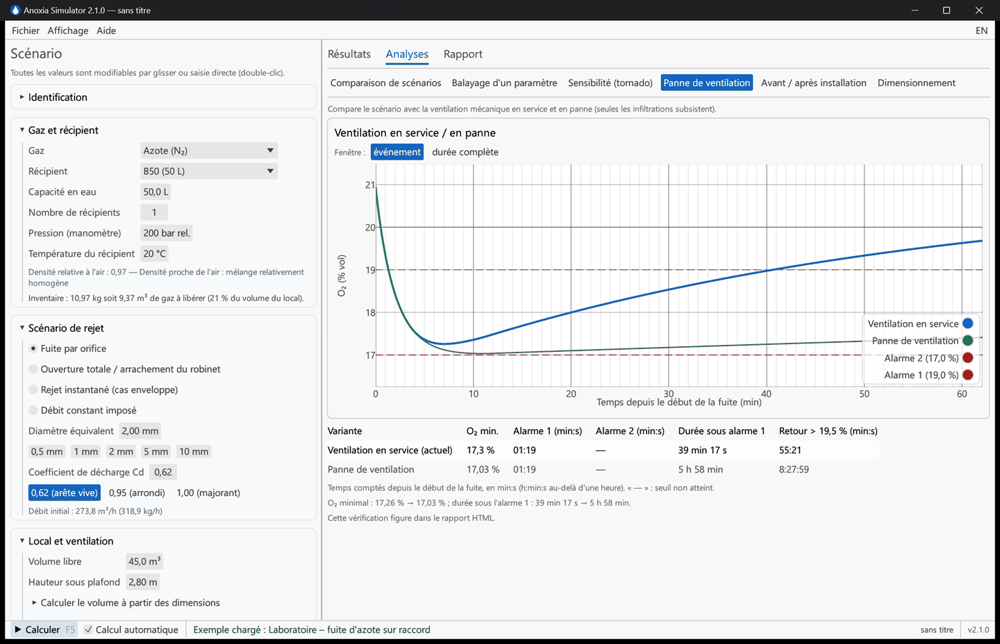

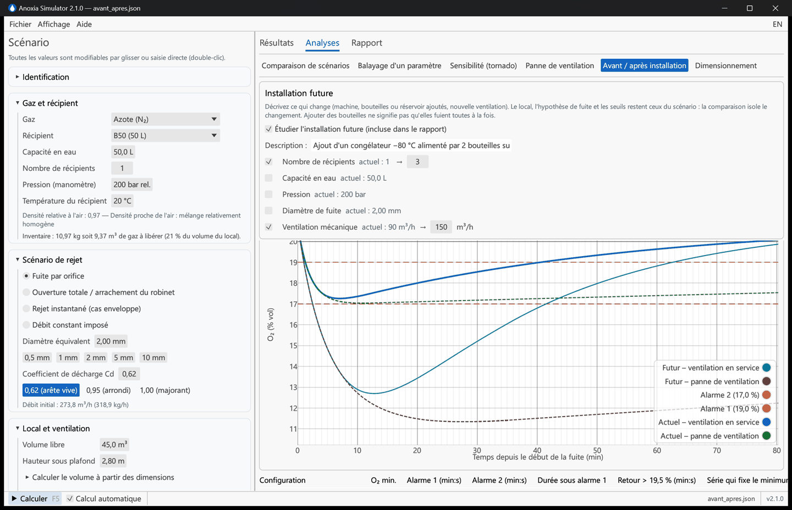

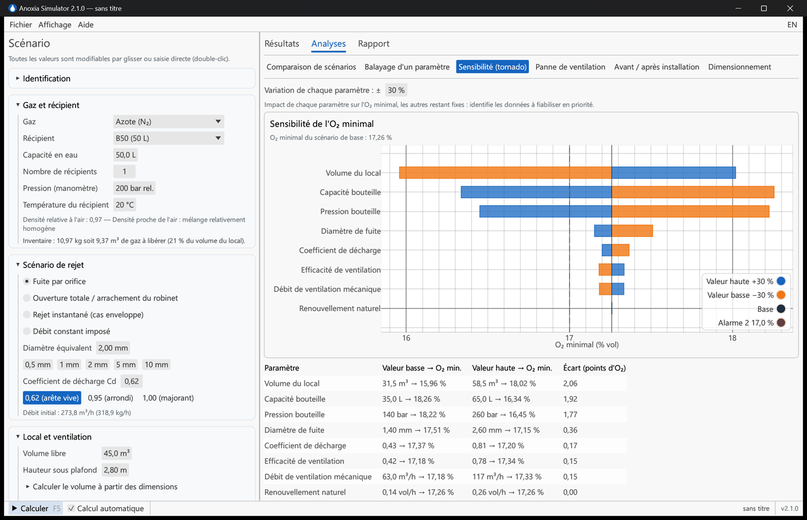

## 5. Dimensionner les mesures de prévention

**Analyses → Dimensionnement** répond à deux questions :

- **Quel débit d'extraction** maintiendrait l'O₂ au-dessus du seuil choisi (alarme 1, alarme 2 ou 19,5 % OSHA), avec l'efficacité de ventilation actuelle ? Le résultat est comparé au débit actuel ; au-delà de 15 vol/h, le logiciel rappelle qu'il faut d'abord agir à la source. Le bouton *Appliquer* reporte le débit dans le scénario.
- **Quel diamètre de fuite maximal** serait tolérable avec la ventilation actuelle ? C'est la donnée utile pour dimensionner un orifice de restriction ou un limiteur de débit.

Pour le CO₂, le critère impose aussi CO₂ ≤ 3 % (VLCT).

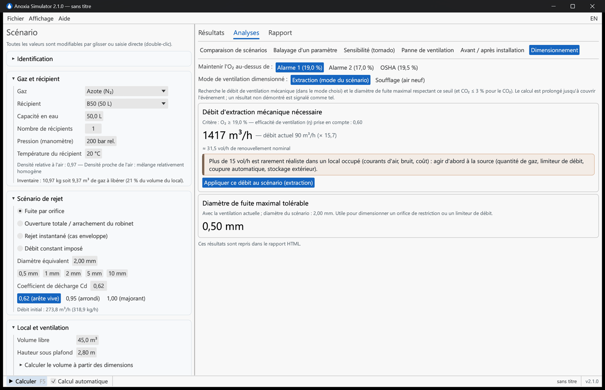

## 6. Documenter, enregistrer, exporter

- **Identification** (en haut du panneau de gauche) : référence du document, site, bâtiment, local, rédacteur, vérificateur, commentaires. Ces informations figurent dans le rapport et son bloc de validation.
- **Enregistrer le scénario** : *Fichier → Enregistrer* (Ctrl+S) crée un fichier JSON rechargeable. Les fichiers de la version 1 sont convertis automatiquement. Un point « • » après le nom du fichier signale des modifications non enregistrées ; le logiciel demande confirmation avant de les perdre.
- **Recommandations : validation par le rédacteur** (onglet *Rapport*). Le logiciel propose des mesures à partir du scénario ; la personne qui signe décide. Chaque proposition a une case à cocher et un champ *Commentaire du rédacteur* (« déjà en place », « sans objet car… »). Les propositions écartées sont listées en fin de section du rapport avec cette justification, et un champ libre *Mesures complémentaires* accueille les mesures propres au site. Ces choix sont enregistrés dans le fichier de scénario.
- **Rapport HTML** (onglet *Rapport* ou Ctrl+E) : document autonome, sans connexion Internet, qui s'ouvre dans un navigateur, Word ou LibreOffice et s'imprime en PDF (*Imprimer → Enregistrer au format PDF*). Il contient la synthèse et les messages clés en clair, les graphiques, les données d'entrée, les seuils, le dimensionnement et la vérification « panne de ventilation » (recalculés à l'export, le critère de dimensionnement étant celui choisi dans *Analyses → Dimensionnement*), les recommandations retenues, les repères physiologiques, les hypothèses et limites, et un bloc de validation. Sa langue se choisit indépendamment de celle de l'interface.
- **Séries temporelles (CSV)** : une ligne par pas de temps, en-têtes lisibles avec unités (temps, O₂ bien mélangé, O₂ retenu pour le classement, zones, CO₂, débit massique, pression du récipient, masse rejetée), pour un traitement dans un tableur (séparateur « ; » et virgule décimale en français, « , » et point en anglais ; encodage reconnu par Excel).

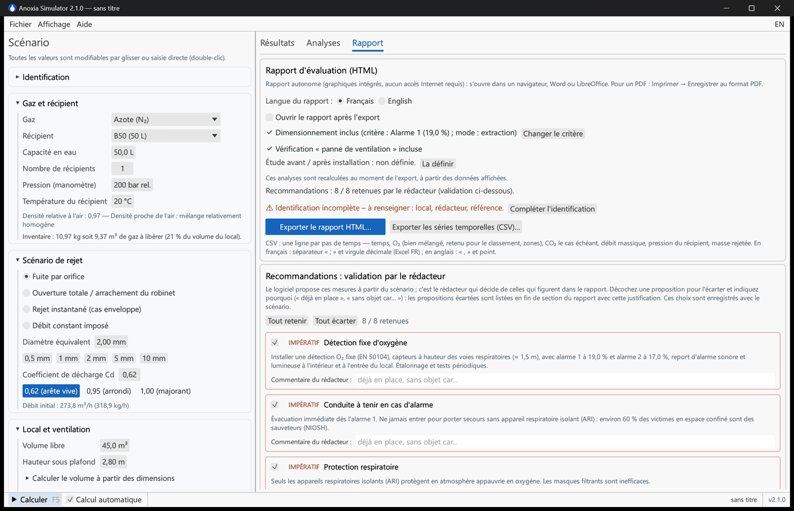

## 7. Exemples fournis

*Fichier → Exemples de scénarios* charge cinq cas représentatifs :

| Exemple | Enseignement |
|---|---|
| Laboratoire – fuite d'azote sur raccord | Cas courant : une fuite de 2 mm suffit à franchir l'alarme 1 dans une salle de 45 m³. |
| Atelier de soudage – arrachement de robinet d'argon | Rejet rapide d'un gaz lourd : importance de la couche au sol. |
| Stockage de CO₂ – local non ventilé | Le CO₂ est toxique bien avant que l'oxygène ne manque. |
| Local hélium – cadre de 9 bouteilles | Gaz léger : accumulation en partie haute, travaux en hauteur. |
| Local gaz – cadre de 12 bouteilles d'azote | Inventaire important dans un petit local : agir à la source. |

## 8. Raccourcis et astuces

| Raccourci | Action |
|---|---|
| F5 | Calculer |
| F1 | Guide scientifique et méthode |
| Ctrl+N / Ctrl+O | Nouveau / Ouvrir un scénario |
| Ctrl+S / Ctrl+Maj+S | Enregistrer / Enregistrer sous |
| Ctrl+E | Exporter le rapport HTML |
| Ctrl + molette, glisser, double-clic | Zoomer, déplacer, réinitialiser un graphique |

- Les en-têtes *Aller à* en haut de l'onglet Résultats font défiler directement vers le graphique, les seuils, les recommandations ou les contrôles.
- *Aide → Dossier de validation* recalcule en direct les 59 cas de comparaison aux références (NIST, fournisseurs, INRS, BCGA, Fermilab, ODHMOD, essais) : 55 cas contrôlés automatiquement, affichés « 55 / 55 cas conformes », et 4 cas documentés (arrondis de l'INRS, air expulsé dans ODHMOD, donnée MiniCLEAN à confirmer).
- Le thème sombre est dans *Affichage*.

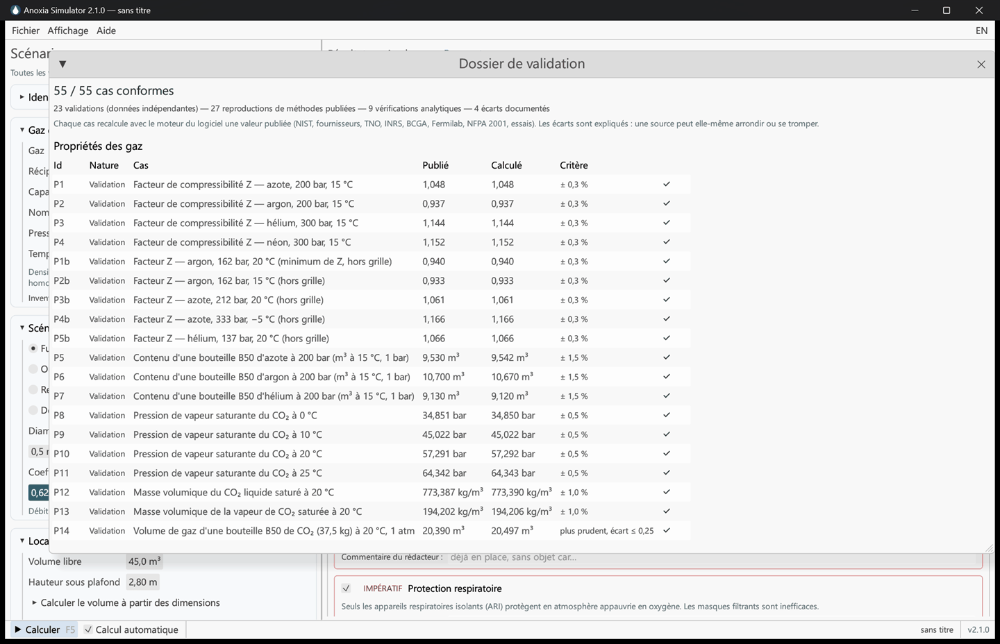

## 9. Questions fréquentes

**Le bandeau indique « Alarme 1 » mais une ligne mentionne « Alarme 2 » : lequel retenir ?**
La première ligne est le résultat de la simulation dynamique (vidange réelle, ventilation, mélange). La seconde est l'approche enveloppe réglementaire : tout l'inventaire libéré d'un coup, sans ventilation, méthode par déplacement de l'INRS et de la BCGA. Retenez l'approche enveloppe si la ventilation ou le mélange ne peuvent pas être garantis, et dans tous les cas documentez les deux.

**Mon résultat diffère de la méthode manuelle de l'INRS (10 m³ par B50).**
L'INRS arrondit le contenu d'une bouteille d'azote à 200 bar à 10 m³ (gaz parfait, pression × volume). Le gaz réel en contient 9,4 m³ à 20 °C (données NIST, confirmées par les fiches Linde). Le logiciel affiche aussi le calcul manuel simplifié dans les *Contrôles indépendants* pour que vous retrouviez exactement le chiffre d'un calcul à la main.

**Quel coefficient de décharge choisir ?**
0,62 pour une fuite par un orifice à arête vive (raccord, percement) ; 1,0 si vous voulez une borne supérieure ou pour une rupture franche. L'analyse de sensibilité montre que son influence est modérée par rapport au volume du local ou à la quantité de gaz.

**Extraction ou soufflage ?**
Si le local est ventilé par un extracteur seul (local en dépression), choisissez *Extraction* : une partie de l'air extrait est du gaz rejeté, l'air neuf réellement entrant est moindre. Si l'air neuf est soufflé (ou double flux équilibré), choisissez *Soufflage*.

**Que représente l'efficacité de ventilation η ?**
La part du débit qui dilue réellement la zone occupée. Une extraction mal placée peut court-circuiter l'air neuf vers la sortie sans balayer le local. Sans mesure, 0,6 est une valeur prudente usuelle ; 1,0 suppose un mélange parfait.

**Le modèle bi-zone est-il fiable ?**
Il donne une tendance (couche au sol pour les gaz lourds, au plafond pour les gaz légers) confirmée qualitativement par des essais, mais ses paramètres ne sont pas calés sur des mesures : il est indicatif. Les fosses, caniveaux et le voisinage immédiat de la fuite peuvent être bien plus dangereux que la moyenne calculée.

**Pourquoi le logiciel n'écrit-il jamais « sûr » ?**
Parce qu'un modèle simplifié ne peut pas l'établir, et que l'anoxie ne provoque aucun signe d'alerte ressenti. Le classement « aucun seuil franchi » signifie seulement qu'aucun seuil n'est atteint dans ce modèle : il faut mesurer avant d'entrer.

**Que faire des liquides cryogéniques (azote liquide, hélium liquide) ?**
Utilisez le scénario *Débit constant imposé* avec l'aide de conversion (1 L d'azote liquide ≈ 692 L de gaz) et cochez *Gaz froid issu d'un liquide cryogénique* : le gaz froid est traité comme un gaz lourd. Les flaques, nuages froids et jets ne sont pas modélisés.

**Puis-je m'appuyer sur ces résultats dans un document unique ou une étude de dangers ?**
Oui comme élément de criblage et de dimensionnement, à condition de citer les hypothèses (elles figurent dans le rapport) et de faire valider l'étude par une personne compétente. Le dossier de validation documente la fidélité du modèle aux références ; il indique aussi son domaine d'emploi et ce qui relève d'une étude spécifique (CFD, mesures).
