# User guide — Anoxia Simulator 2.1

This guide is for safety professionals, HSE/QHSE managers, safety engineers and laboratory managers. It explains how to carry out an oxygen-deficiency (anoxia) risk study with the software, from the first start to the exported report. The equations and scientific references are in the built-in guide (*Help → Scientific guide and method*, F1); the comparison with reference data is in [VALIDATION.md](../VALIDATION.md) (French).

> **Important.** The software is an assessment aid. Its results must never be used to declare an atmosphere safe: only measurement with a calibrated detector is authoritative, and the study must be validated by a competent person.

## Contents

1. [Installation and first start](#1-installation-and-first-start)
2. [Describe the scenario](#2-describe-the-scenario)
3. [Read the results](#3-read-the-results)
4. [Analyse the robustness](#4-analyse-the-robustness)
5. [Size the prevention measures](#5-size-the-prevention-measures)
6. [Document, save, export](#6-document-save-export)
7. [Built-in examples](#7-built-in-examples)
8. [Shortcuts and tips](#8-shortcuts-and-tips)
9. [Frequently asked questions](#9-frequently-asked-questions)

The screenshots below show the French interface; switch to English with the **EN / FR** button at the top right.

---

## 1. Installation and first start

**Installation.** Download `Anoxia-Simulator-vX.Y.Z-windows.zip`, unzip it anywhere and run `Anoxia-Simulator.exe`. No installation and no Internet connection are required. Windows 10 and 11 are supported.

**First start.** A getting-started tutorial opens: six steps, each with a button that performs the corresponding action in the software (load an example, open a tab, etc.). Close it whenever you like and find it again under *Help → Getting started*. The *Show at start-up* box disables it.

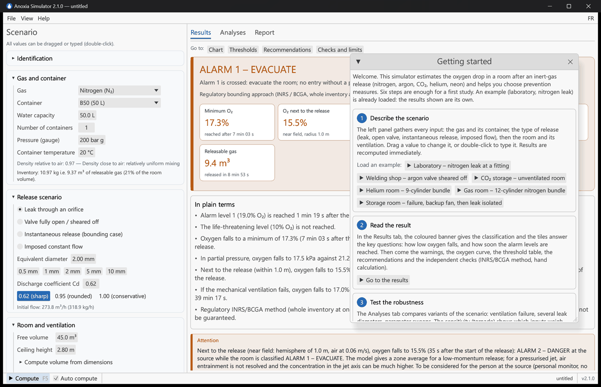

**Screen layout.**

| Area | Role |
|---|---|
| Left panel "Scenario" | Every input, grouped in collapsible sections. |
| **Results** tab | Classification, alarm times, curves, thresholds, recommendations. |
| **Analyses** tab | Comparisons, ventilation failure, sensitivity, sizing. |
| **Report** tab | HTML report and CSV export. |
| Status bar (bottom) | *Compute* button (F5), auto compute, messages, file name, version. |

Preferences (language, dark theme, tutorial) are remembered between sessions.

## 2. Describe the scenario

Drag a numeric value to change it, or double-click to type it. By default results are recomputed on every change (*Auto compute*); a simulation takes a few milliseconds.

### 2.1 Gas and container

- **Gas**: nitrogen, argon, CO₂, helium or neon. The density relative to air is shown; heavy gases (argon, CO₂) accumulate at low level, light gases (helium, neon) at high level.
- **Container**: 2 to 50 L cylinders, tanks, or a custom capacity. For a bundle or battery of manifolded cylinders, set the **number of containers**.
- **Pressure (gauge)**: the pressure read on the gauge, in bar relative (200 or 300 bar for a full cylinder). The real contents are computed with real-gas properties (NIST tables), within 1% of supplier data sheets.
- **CO₂**: stored liquefied; enter the **filling ratio** (0.75 kg/L for a 37.5 kg B50) and the **withdrawal phase** (vapour for an upright cylinder, liquid with a dip tube or a lying cylinder, much faster). Above about 22 °C a cylinder filled at 0.75 kg/L is liquid-full: the software accounts for it and warns.
- **Container temperature**: affects the contents and, for CO₂, the saturation pressure.

The **inventory** (releasable mass and gas volume, as a % of the room volume) is shown under the fields: a first order of magnitude of the risk.

### 2.2 Release scenario

| Scenario | When to use it | Parameters |
|---|---|---|
| **Leak through an orifice** | Leak at a fitting, hose or regulator. | Equivalent diameter (0.5–3 mm for a fitting), discharge coefficient Cd. |
| **Valve fully open / sheared off** | Valve wide open (seat ≈ 4 mm) or torn off (cylinder neck ≈ 10–15 mm). | Diameter, Cd = 1 by default (upper bound). |
| **Instantaneous release (bounding case)** | Upper bound: whole inventory at once, INRS (ED 155) and BCGA (CP 52) method. | None. |
| **Imposed constant flow** | Known flow: process line, welding shielding gas, liquid-nitrogen boil-off. | Flow (m³/h) and duration. A helper converts L/min and litres of cryogenic liquid (LN₂, LAr, LHe). |

**Discharge coefficient Cd** (TNO Yellow Book): 0.62 for a sharp-edged orifice (usual value), 0.95 for a rounded orifice, 1.0 as a conservative bound. The computed **initial flow** is displayed under the fields.

### 2.3 Room and ventilation

- **Free volume**: air volume of the room minus bulky equipment. *Compute volume from dimensions* multiplies L × W × H.
- **Mechanical ventilation running**: untick to simulate a failure.
  - **Exhaust (room under depression)**: the usual case for a gas room. Fresh air entering equals the extracted flow minus the released gas flow (Fermilab FESHM 4240 method): the conservative assumption, used by default.
  - **Supply / balanced**: the fan flow is entirely fresh air.
- **Natural air change**: infiltration, always present. Guide: 0–0.2 ACH for a very airtight room (cold room), 0.2–0.5 for a closed room, 0.5–1 for a leaky plant room, above 1 if doors are often open.
- **Ventilation effectiveness η**: share of the flow actually diluting. 1 = perfect mixing (theoretical), 0.8 good mixing, 0.6 usual prudent value, 0.4 poor mixing (short-circuit between supply and extract).
- **Events during the release** (collapsed section): a timeline of dated events, counted from the start of the release. Three kinds: *mechanical ventilation stops* (failure, power cut), *a ventilation starts* (backup fan, emergency extraction triggered by the detector, restart) at a given flow in exhaust or supply mode, and *leak isolated* (valve closed, automatic shut-off: no more gas enters). The computation lands exactly on each event, simultaneous events are applied in a fixed order (stop, start, isolation) and the events appear as dotted vertical lines on the curves and in the report. Without events, the ventilation described above runs for the whole duration. The *ventilation failure* study of the Analyses tab remains a total failure from the start, without backup fan.

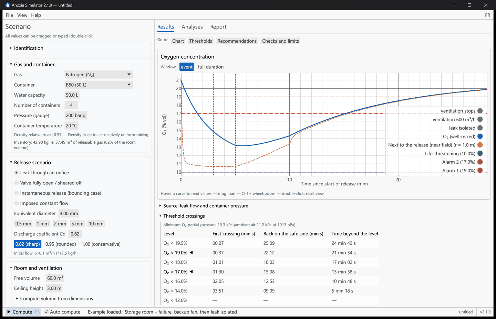

*Timeline example: the extraction fails 3 min into the leak, an emergency extraction starts at 5 min, the leak is isolated at 10 min; the events are listed in plain terms and marked on the curve.*

### 2.4 Alarm levels and advanced options

- **O₂ alarm levels**: *France – INRS* profile (19% and 17%, usual detector settings), *OSHA* (19.5% and 16%) or custom.
- **Two-zone model** (*Advanced options*): enabled automatically for heavy and light gases; it estimates the concentration in the accumulation layer (floor or ceiling). Its parameters (layer thickness, share of the release entering the layer, inter-zone exchange, extraction location) are assumptions: the result is **indicative**, and the classification uses the worse of the two models.
- **Near field** (*Advanced options*, on by default): oxygen next to the release point, in a hemisphere of adjustable radius (1 m by default) exchanging with the rest of the room at ½ × surface × air speed (0.06 m/s by default, a prudent value; 0.05 to 0.3 m/s measured in workplaces). This is the near-field / far-field model of industrial hygiene (Nicas, AIHA IH Mod, ODHMOD). It gives a zone average for a low-momentum release: for a pressurised jet, air entrainment is not resolved and the concentration in the jet axis can be much higher. By default it is shown separately and flagged when more severe; the *Include the near field in the classification* box adds it to the classification.
- **Container blowdown**: isothermal by default (conservative); adiabatic as an option (indicative, ideal gas).
- **Maximum simulated time**, room temperature and atmospheric pressure.

## 3. Read the results

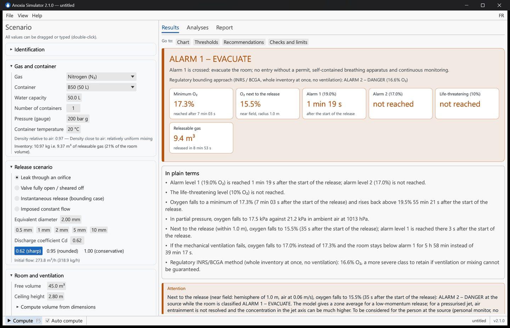

From top to bottom:

1. **Coloured banner**: the classification, from "no threshold reached" to "life-threatening", with a conclusion sentence. When the regulatory displacement method (INRS/BCGA) gives a more severe class than the simulation, it is stated on a second line.
   - **In plain terms**: right under the banner, three to five sentences say the essentials without jargon: when the alarm levels are reached ("2 s after the start of the release"), how low oxygen falls and when it recovers, CO₂ where relevant, and what changes if the mechanical ventilation fails. The same sentences open the report.
2. **Tiles**: minimum O₂ and when it is reached, O₂ next to the release (near field), time to alarm 1, alarm 2 and 10% O₂, peak CO₂ for CO₂, releasable gas volume and release duration (or the volume actually released when the leak is isolated).
3. **Warnings**, ranked by severity: toxic CO₂, heavy or light gas, short escape time, indicative two-zone model, etc.
4. **Oxygen curve**: by default the "event" window focuses on the O₂ dip; "full duration" shows the whole recovery. Hover the curve to read values; Ctrl + wheel zooms, drag pans, double-click resets. For CO₂, a second chart shows the CO₂ concentration against the 8-h OEL (0.5%), the STEL (3%) and the IDLH (4%).
5. **Source** (collapsed): leak flow and container pressure during the blowdown.
6. **Threshold crossings**: the minimum **oxygen partial pressure** (kPa) against the ambient value at the room pressure, then, for each O₂ (and CO₂) level, the first crossing, the return to the safe side and the time beyond the level. The indicative time between alarm 1 and the next dangerous level is recalled. Below about 900 hPa (altitude) a warning recalls that the same percentage is more hypoxic.
7. **Recommendations**, ranked (mandatory, strongly recommended, good practice): detection, alarm response, respiratory protection (SCBA only), automatic shut-off, training, low points, ventilation reliability. They are proposals: the author decides, in the *Report* tab, which ones appear in the report (see § 6).
8. **Independent checks**: the three "whole inventory at once, no ventilation" calculations (INRS/BCGA displacement method, NFPA 2001 free efflux, simplified hand calculation an auditor will redo), with their classification.
9. **Model assumptions and limitations**, disclaimer and computation date.

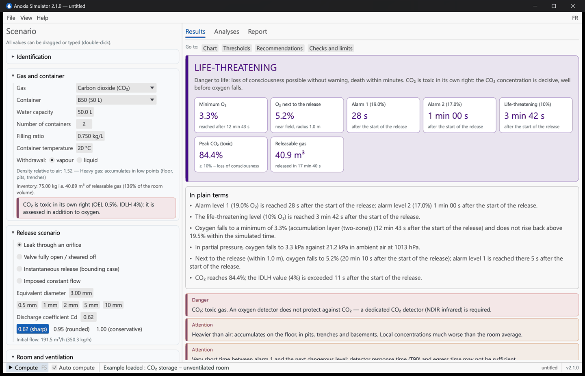

*CO₂ case: CO₂-specific labels and limits are shown, and the lower layer of the two-zone model is plotted.*

## 4. Analyse the robustness

The **Analyses** tab runs dozens of simulations in the background; results are cached and refreshed when the inputs change.

| Study | What it shows |
|---|---|
| **Scenario comparison** | O₂ curves for several values of one parameter (leak diameter, volume, ventilation flow…) around the current value, with a table of times. |
| **Parameter sweep** | Minimum O₂ and alarm times versus one parameter, over an adjustable range. |
| **Sensitivity (tornado)** | Impact of ±30% on each parameter: identifies the inputs to firm up first. |
| **Ventilation failure** | The same scenario with and without mechanical ventilation: minimum O₂, time below alarm 1, return above 19.5%. |
| **Before / after installation** | The current installation and the planned one (added containers, pressure, leak, ventilation), each in normal operation and with the ventilation failed. Describe the change, tick the modified values: four curves, a table with the series setting the minimum, and times marked "≥" when the level is still exceeded at the end of the computation. The leak hypothesis stays that of the scenario: adding cylinders does not mean they all leak together. The study is saved with the scenario and included in the report. |

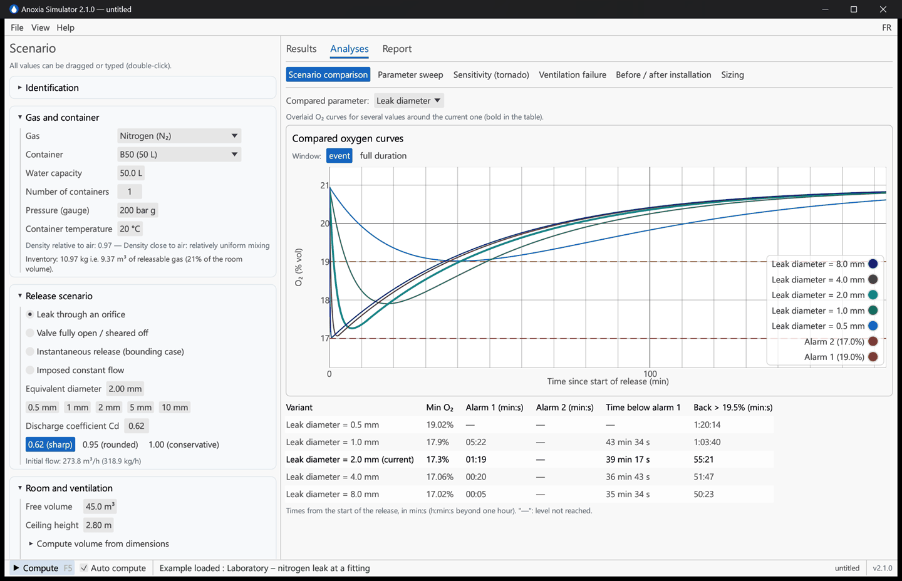

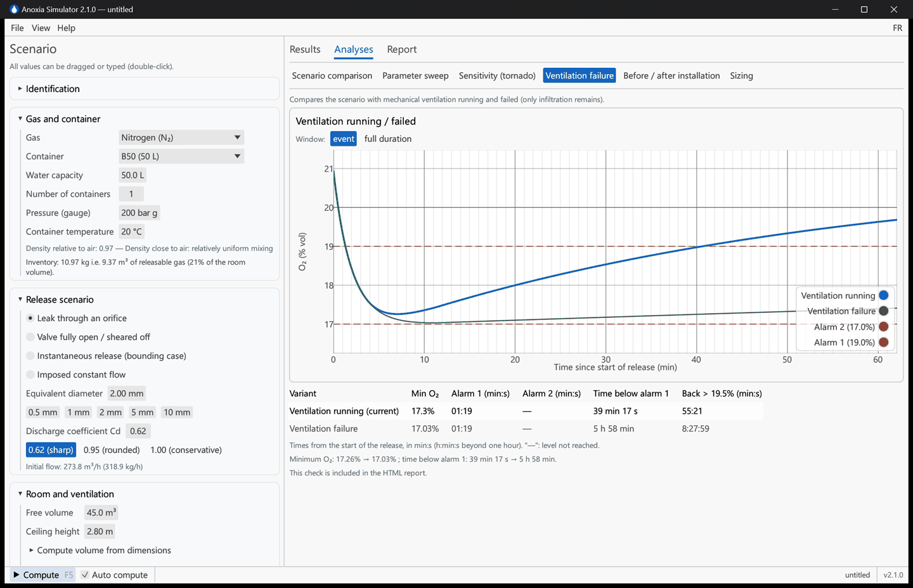

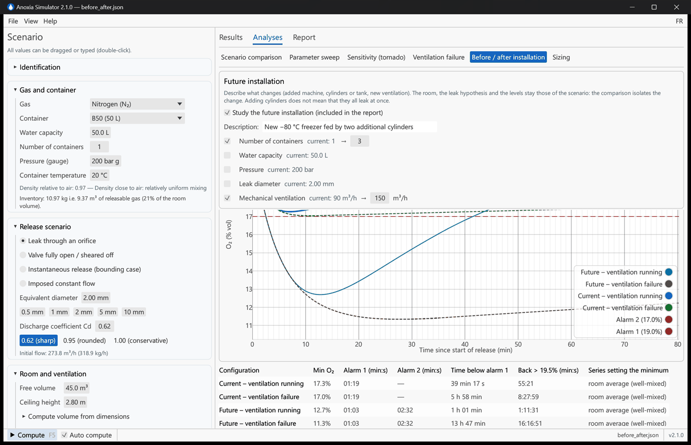

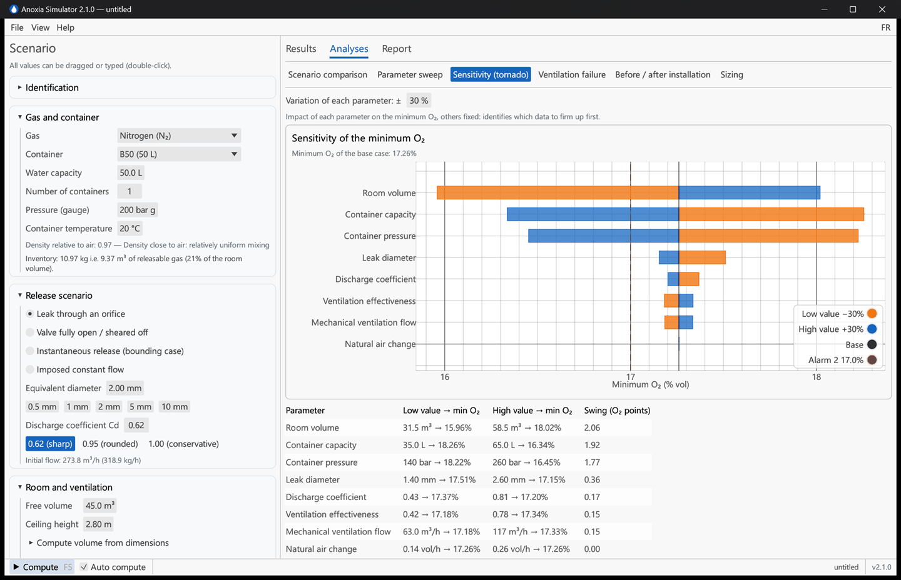

## 5. Size the prevention measures

**Analyses → Sizing** answers two questions:

- **Which extraction flow** would keep O₂ above the chosen level (alarm 1, alarm 2 or 19.5% OSHA) with the current ventilation effectiveness? The result is compared with the current flow; above 15 ACH the software reminds you to act at the source first. The *Apply* button copies the flow into the scenario.
- **Which maximum leak diameter** would be tolerable with the current ventilation? That is the figure needed to size a restriction orifice or a flow limiter.

For CO₂ the criterion also requires CO₂ ≤ 3% (STEL).

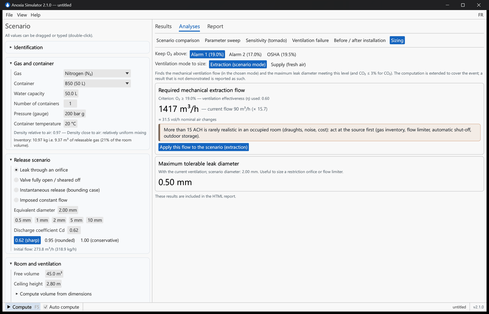

## 6. Document, save, export

- **Identification** (top of the left panel): document reference, site, building, room, author, reviewer, comments. They appear in the report and its approval block.
- **Save the scenario**: *File → Save* (Ctrl+S) writes a reloadable JSON file. Version 1 files are converted automatically. A "•" after the file name flags unsaved changes; the software asks before losing them.
- **Recommendations: author's validation** (*Report* tab). The software proposes measures from the scenario; the person who signs decides. Each proposal has a tick box and an *Author's comment* field ("already in place", "not applicable because…"). Excluded proposals are listed at the end of the report section with that justification, and a free *Additional measures* field receives site-specific measures. These choices are saved in the scenario file.
- **HTML report** (*Report* tab or Ctrl+E): a self-contained document, no Internet connection needed, which opens in a browser, Word or LibreOffice and prints to PDF (*Print → Save as PDF*). It contains the summary and the plain-language key messages, charts, inputs, thresholds, the sizing and the ventilation-failure check (recomputed at export, with the criterion chosen in *Analyses → Sizing*), the retained recommendations, physiological reference, assumptions and limitations, and an approval block. Its language is chosen independently of the interface.
- **Time series (CSV)**: one row per time step, readable headers with units (time, well-mixed O₂, O₂ used for classification, zones, CO₂, mass flow, container pressure, released mass), for a spreadsheet (";" separator and decimal comma in French; "," and decimal point in English; encoding recognised by Excel).

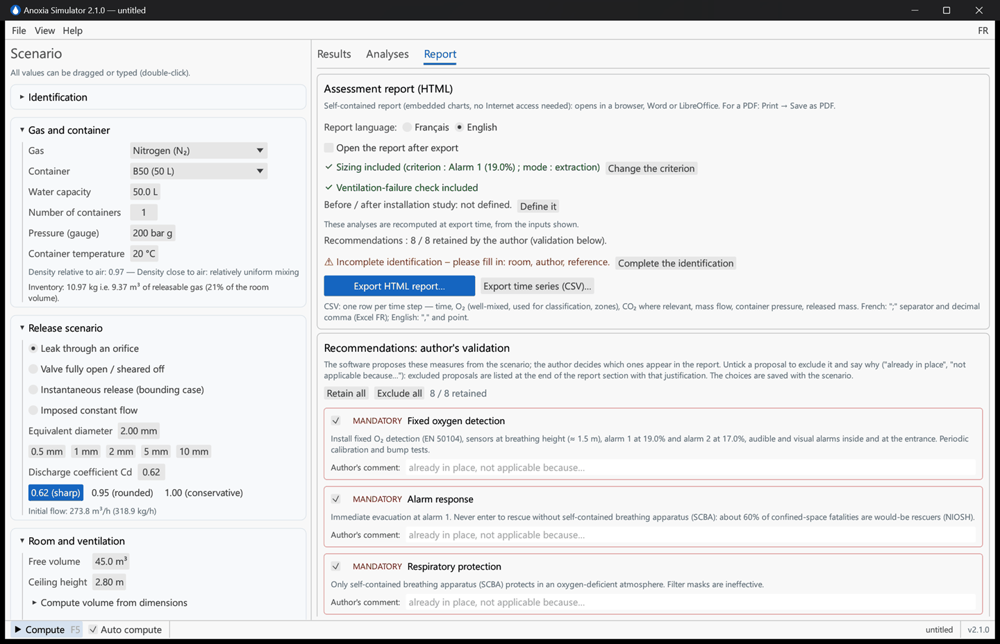

## 7. Built-in examples

*File → Example scenarios* loads five representative cases:

| Example | Lesson |
|---|---|
| Laboratory – nitrogen leak at a fitting | Common case: a 2 mm leak is enough to cross alarm 1 in a 45 m³ room. |
| Welding shop – argon valve sheared off | Fast release of a heavy gas: the floor layer matters. |
| CO₂ storage – unventilated room | CO₂ is toxic long before oxygen runs short. |
| Helium room – 9-cylinder bundle | Light gas: accumulation at high level, work at height. |
| Gas room – 12-cylinder nitrogen bundle | Large inventory in a small room: act at the source. |

## 8. Shortcuts and tips

| Shortcut | Action |
|---|---|
| F5 | Compute |
| F1 | Scientific guide and method |
| Ctrl+N / Ctrl+O | New / Open a scenario |
| Ctrl+S / Ctrl+Shift+S | Save / Save as |
| Ctrl+E | Export the HTML report |
| Ctrl + wheel, drag, double-click | Zoom, pan, reset a chart |

- The *Go to* links at the top of the Results tab scroll directly to the chart, thresholds, recommendations or checks.
- *Help → Validation dossier* recomputes live the 59 comparison cases against references (NIST, suppliers, INRS, BCGA, Fermilab, ODHMOD, experiments): 55 cases checked automatically, shown as "55 / 55 cases passed", plus 4 documented items (INRS rounding, expelled air in ODHMOD, MiniCLEAN datum to be confirmed).
- The dark theme is under *View*.

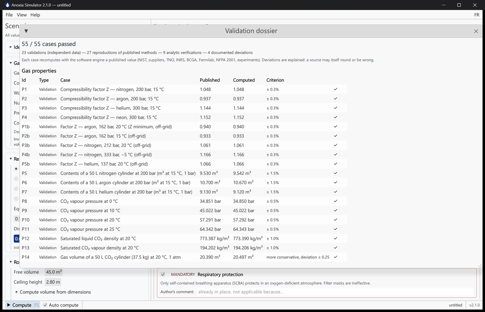

## 9. Frequently asked questions

**The banner says "Alarm 1" but a line mentions "Alarm 2": which one applies?**
The first line is the dynamic simulation (real blowdown, ventilation, mixing). The second is the regulatory bounding approach: whole inventory at once, no ventilation, INRS/BCGA displacement method. Use the bounding approach if ventilation or mixing cannot be guaranteed, and document both in any case.

**My result differs from the INRS hand method (10 m³ per B50).**
INRS rounds the contents of a nitrogen cylinder at 200 bar to 10 m³ (ideal gas, pressure × volume). The real gas holds 9.4 m³ at 20 °C (NIST data, confirmed by Linde data sheets). The software also shows the simplified hand calculation in the *Independent checks* so that you can match a manual figure exactly.

**Which discharge coefficient should I use?**
0.62 for a leak through a sharp-edged orifice (fitting, puncture); 1.0 for an upper bound or a full-bore rupture. The sensitivity analysis shows its influence is moderate compared with the room volume or the gas inventory.

**Exhaust or supply?**
If the room is ventilated by an extract fan only (room under depression), choose *Exhaust*: part of the extracted air is released gas, so less fresh air actually enters. If fresh air is supplied (or balanced supply/extract), choose *Supply*.

**What is the ventilation effectiveness η?**
The share of the flow that really dilutes the occupied zone. A badly placed extract can short-circuit fresh air to the outlet without sweeping the room. Without measurements, 0.6 is a usual prudent value; 1.0 assumes perfect mixing.

**Is the two-zone model reliable?**
It gives a trend (floor layer for heavy gases, ceiling layer for light gases) confirmed qualitatively by experiments, but its parameters are not calibrated on measurements: it is indicative. Pits, trenches and the immediate vicinity of the leak can be much more dangerous than the computed average.

**Why does the software never say "safe"?**
Because a simplified model cannot establish it, and anoxia gives no perceived warning. The class "no threshold reached" only means no threshold is reached in this model: measure before entry.

**What about cryogenic liquids (liquid nitrogen, liquid helium)?**
Use the *Imposed constant flow* scenario with the conversion helper (1 L of liquid nitrogen ≈ 692 L of gas) and tick *Cold gas from a cryogenic liquid*: the cold gas is treated as a heavy gas. Pools, cold clouds and jets are not modelled.

**Can I rely on these results in a workplace risk assessment or a safety case?**
Yes, as a screening and sizing element, provided the assumptions are quoted (they are in the report) and the study is validated by a competent person. The validation dossier documents how faithfully the model reproduces reference data; it also states the validity domain and what calls for a specific study (CFD, measurements).
